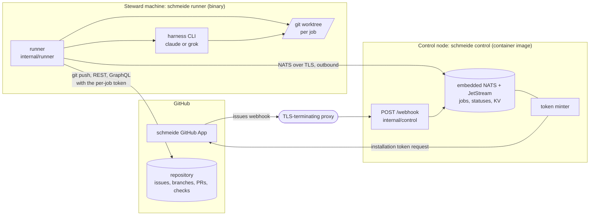

# Architecture

schmeide is the autobutler-org software factory. It takes an assigned GitHub issue that carries the ready label
to a pull request, reviews that pull request with an AI reviewer, and, when the repo asks for it, merges it. One
Go binary, `schmeide`, has two long-running modes. `schmeide control` is the control node: a GitHub App webhook
endpoint and an embedded NATS server with JetStream that holds the job queue and mints a GitHub token for each
job. `schmeide runner` runs on a steward's own machine: it connects out to the control node, pulls that
steward's jobs one at a time, drives an agent harness (Claude Code or the Grok CLI) in a git worktree, runs the
repo's gate, and pushes and opens the pull request as the GitHub App.

This page is the one-screen summary. The detail, with diagrams, is in [`docs/architecture/`](docs/architecture/README.md).
What the factory does feature by feature is in [`docs/user-journeys/`](docs/user-journeys/README.md).

## Load-bearing ideas

- **Runners connect out.** A runner needs no inbound address. It opens one NATS connection to the control node,
  pulls jobs, publishes statuses, and asks for tokens over it.
- **No long-lived GitHub credential on a runner.** The control node mints a GitHub App installation token per
  job, scoped to that one repository, and only for a job subject that belongs to the asking steward.
- **NATS access is per steward.** Each steward has its own NATS user and token (`--runner-tokens`), and NATS
  permissions pin that user to its own job subjects, consumer, status subjects, token subject, and reply inbox.
- **JetStream is the only database.** Jobs, per-issue dedupe records, runner registrations, job statuses, and
  per-job stage records all live in the control node's `--data-dir`. There is no SQL store.
- **A job is acknowledged only at a final state.** A runner heartbeats `InProgress` while it works. A dead runner's
  job is redelivered, and the stage record plus the `<issue>_` branch prefix keep the redelivery from opening a
  second pull request.
- **The job carries the issue text.** The title and body are captured from the webhook that created the job. The
  runner never re-reads the issue, so an edit after the ready label does not change the brief.
- **The repo config is read before the session.** `.schmeide/config.toml` (gate, timeouts, `[automate]`) is
  loaded from the base branch before the harness runs, so a session cannot weaken its own gate or turn on
  factory merge.
- **Files are the session protocol.** A writer session leaves `.schmeide/pr.md`. A reviewer leaves
  `.schmeide/review.md`. The runner reads and deletes them and never parses harness output.
- **Everything that can wait for a person does.** Review fix rounds and factory merge are off unless the repo
  turns them on in `[automate]`.

## Read next

| Doc                                                         | Covers                                                                   |
| ----------------------------------------------------------- | ------------------------------------------------------------------------ |
| [System context](docs/architecture/system-context.md)       | GitHub, the control node, runners, harnesses, what runs where            |
| [Control node](docs/architecture/control-node.md)           | webhook intake, embedded NATS, streams, subjects, consumers, token minting |
| [Runner](docs/architecture/runner.md)                       | job pipeline, worktrees, harness sessions, gate, review, merge           |
| [Job flows](docs/architecture/job-flows.md)                 | sequence diagrams: issue to PR, review, merge, redelivery, pool, retries |
| [Data](docs/architecture/data.md)                           | every persistent store, its owner, and its lifetime                      |
| [Credentials](docs/architecture/credentials.md)             | tokens, secrets, session environment, trust boundaries                   |
| [Build and tooling](docs/architecture/tooling.md)           | commands, Makefile, lint, CI, release, e2e journeys                      |

How to run a control node is in [`docs/DEPLOYMENT.md`](docs/DEPLOYMENT.md). The terms are in
[`docs/GLOSSARY.md`](docs/GLOSSARY.md). The agreed design and its open decisions are in
[`docs/design.md`](docs/design.md).
