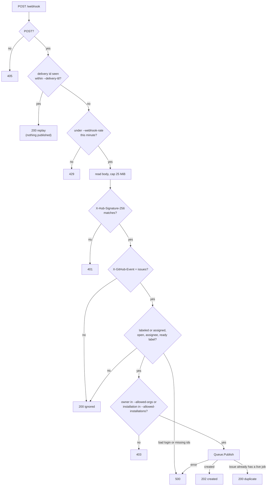
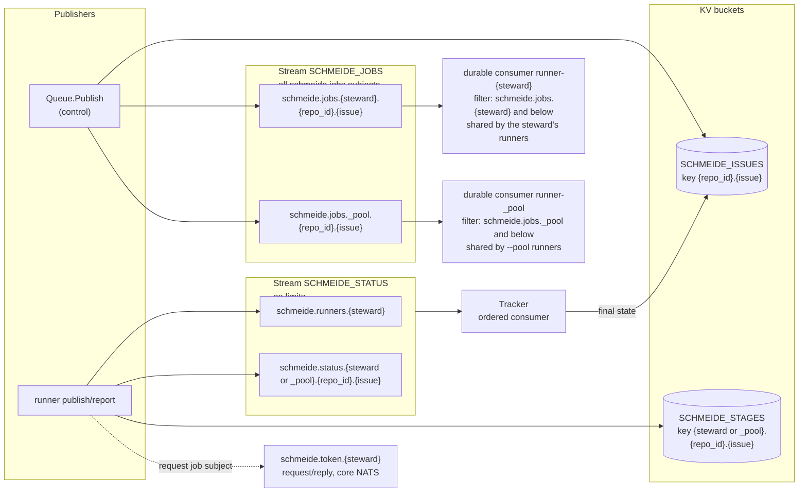

# Control node

`schmeide control` is one process: an HTTP webhook listener and an embedded NATS server with JetStream. It turns
GitHub `issues` webhooks into jobs, holds the queue, records what runners report, and mints a GitHub installation
token for each job a runner asks for. All of it is in `internal/control`.

| File | Owns |
| --- | --- |
| `internal/control/cli.go` | `Main`, `parseControl`, the `controlSettings` table, `--config` file reading, `CheckPrivateKeyFileMode`, `InitConfig` (what `schmeide init` writes) |
| `internal/control/control.go` | `Config`, `Run` (startup order), `Handler` (the `/webhook` endpoint), `WebhookPolicy`, the HTTP server timeouts |
| `internal/control/guard.go` | `webhookGate`: the per-minute rate limit and the delivery-id memory |
| `internal/control/intake.go` | `Job`, `Job.Subject`, `VerifySignature`, `JobFromIssuesEvent`, `Allowlist`, `ParseRunnerTokens`, `Intake.Handle`, `Outcome` |
| `internal/control/queue.go` | `StartQueue`, `Queue.Publish`, `runnerPermissions`, `ServeTokens`, the job stream, the issue and stage buckets |
| `internal/control/status.go` | `State`, `Status`, `Registration`, `Tracker` (`Queue.Track`), the `SCHMEIDE_STATUS` stream, `ReadStatus`, `StatusMain` |
| `internal/control/token.go` | `TokenMinter.Mint`, `ParsePrivateKey`, the App JWT |
| `internal/control/tls.go` | `natsTLSConfig` (cert reload per handshake), `listensBeyondLoopback` |

## Settings

Every setting comes from a flag, a `SCHMEIDE_<NAME>` environment variable, or a `name = value` line in the
`--config` file, in that order of precedence (`parseControl`). The config file is not TOML: blank lines and `#`
lines are skipped, values may be double-quoted, and an unknown name is an error. `schmeide control --help` prints
the table in `controlSettings`.

| Setting | Default | Notes |
| --- | --- | --- |
| `--http-addr` | `:8080` | Plain HTTP webhook listener. |
| `--webhook-rate` | `1000` | Requests per minute. Must be positive. |
| `--delivery-ttl` | `10m` | How long an `X-Github-Delivery` id is remembered. Must be positive. |
| `--nats-addr` | `127.0.0.1:4222` | Runners connect here. |
| `--nats-tls-cert-file`, `--nats-tls-key-file` | none | Both or neither. |
| `--runner-tokens` | required | `<login>:<token>,...`, one per steward. |
| `--data-dir` | `schmeide-data` | JetStream store directory. The image sets `SCHMEIDE_DATA_DIR=/data`. |
| `--webhook-secret` | required | |
| `--ready-label` | `schmeide:ready` (`DefaultReadyLabel`) | |
| `--allowed-orgs`, `--allowed-installations` | at least one required | `ParseAllowlist` refuses both empty. |
| `--github-app-id`, `--github-app-private-key-file` | required | The key file must not be group- or other-readable. |
| `--github-api-url` | `https://api.github.com` | Used for minting only. |

## Startup

`Run` in `internal/control/control.go` starts things in this order, and any failure stops startup:

1. Parse the allowlist, runner tokens, webhook rate, and delivery TTL. Read and parse the App private key
   (`ParsePrivateKey` accepts PKCS#1 or PKCS#8 RSA).
2. Warn when NATS has no TLS and `--nats-addr` is beyond loopback.
3. `StartQueue`: start the embedded NATS server, connect in-process as `_schmeide_control` with a random
   password (`rand.Text()`), open the `SCHMEIDE_ISSUES` and `SCHMEIDE_STAGES` buckets and the `SCHMEIDE_JOBS`
   stream (`Queue.openJobs`).
4. `Queue.ServeTokens`: subscribe to `schmeide.token.*`.
5. `Queue.Track`: create or update `SCHMEIDE_STATUS`, replay its whole history, then follow new messages. Only
   after the replay is `q.tracker` set, so pool routing knows which stewards have runners before the first
   webhook is accepted.
6. Listen on `--http-addr` and serve `/webhook`.

On SIGINT or SIGTERM the HTTP server gets 10 seconds to finish requests in flight, then the deferred
`Queue.Close` stops NATS.

## Webhook intake



- `Handler` (`control.go`) checks the replay memory before the rate limit and before the signature, so a
  repeated delivery id costs nothing. A delivery id is remembered only after a successful outcome
  (`webhookGate.remember`), so a failed delivery can be redelivered. An empty id is never a replay. Both the
  rate limit and the id memory are in memory and reset on restart. `Queue.Publish` dedupes across restarts.
- The HTTP server sets `ReadHeaderTimeout` 10s and `ReadTimeout` 30s (`newWebhookServer`).
- `VerifySignature` is an HMAC-SHA256 over the raw body, compared with `hmac.Equal`.
- `JobFromIssuesEvent` builds a `Job` only for actions `labeled` and `assigned` (`jobActions`). Edits and reopens
  never create a job, because only a person with triage access can label or assign. The steward is
  `issue.assignee`, or the first of `issue.assignees`. A login with NATS subject syntax (`.`, `*`, `>`, space) or
  equal to `_pool` is an error.
- The `Job` carries `repo`, `repo_id`, `issue`, `steward`, `pool`, `installation_id`, `title`, and `body`. The
  title and body are the issue as it stood in that delivery.

## Embedded NATS and JetStream

`StartQueue` runs `server.NewServer` with JetStream on, `StoreDir = --data-dir`, one NATS user per steward from
`--runner-tokens` with `runnerPermissions(steward)`, plus the control user, which has no permission limits.
Logging and signal handling of the embedded server are off (`NoLog`, `NoSigs`). There is no NATS account
configuration, so everything is in the default global account.



### Streams, buckets, and subjects

| Name | Kind | Subjects or keys | Written by | Read by |
| --- | --- | --- | --- | --- |
| `SCHMEIDE_JOBS` (`JobStream`) | stream, `MaxMsgs` 100,000 (`jobStreamMaxMsgs`), discard oldest | `schmeide.jobs.<steward>.<repo_id>.<issue>`, `schmeide.jobs._pool.<repo_id>.<issue>` | `Queue.Publish` | runner consumers; `tokenFor` via `GetLastMsgForSubject`; `seedIssues` at startup |
| `SCHMEIDE_STATUS` (`StatusStream`) | stream, default limits (unbounded) | `schmeide.runners.<steward>` (`Registration`), `schmeide.status.<steward or _pool>.<repo_id>.<issue>` (`Status`) | runners; `Queue.Publish` (`published`, and `failed` when the job could not be stored) | `Tracker` (replay plus ordered consumer), `ReadStatus` for `schmeide status`, runners restoring the attempt count |
| `SCHMEIDE_ISSUES` (`issueBucket`) | KV, default config | `<repo_id>.<issue>` → `issueRecord{subject, state, after}` | `Queue.Publish`, `Tracker.finish`, `seedIssues` | `Queue.Publish` dedupe |
| `SCHMEIDE_STAGES` (`StageBucket`) | KV, default config | `<steward or _pool>.<repo_id>.<issue>` → runner `stage` record | runners (`Runner.mark`, deleted at a final state) | runners (`Runner.recordedStage`) |
| `schmeide.token.<steward>` (`TokenSubjectPrefix`) | core NATS request/reply | request body is a job subject, reply is `TokenReply` | runners, `schmeide doctor` (empty body as a liveness ping) | `Queue.ServeTokens` |

The status stream subjects are the same subjects runners have always published on. The stream captures them, so
publishers do not need JetStream acks for statuses.

### Consumers

The control node creates no job consumers. Each runner calls `CreateOrUpdateConsumer` on `SCHMEIDE_JOBS` at
startup (`Runner.register` in `internal/runner/runner.go`):

- `runner-<steward>` (`ConsumerName`), filter `schmeide.jobs.<steward>.>` (`JobFilter`), explicit ack, `AckWait`
  from the runner's `--ack-wait`. All of one steward's runners share it, so each job is delivered to one of them.
- `runner-_pool`, filter `schmeide.jobs._pool.>`, created only by a runner started with `--pool`. All pool runners
  share it.

Because the consumer is shared and created or updated by each runner, the last runner to start sets `AckWait`
for that consumer. No `MaxDeliver` is set, so JetStream redelivers without limit. The runner's own attempt count
(see [Runner](runner.md#retries-and-acknowledgment)) is what ends retries.

### Runner permissions

`runnerPermissions(steward)` in `queue.go` lets a steward's NATS user publish only to:

- consumer create, info, next, and ack for `runner-<steward>` with exactly its own filter, and the same for
  `runner-_pool` with the pool filter;
- `schmeide.runners.<steward>`, `schmeide.status.<steward>.>`, and `schmeide.status._pool.>`;
- `schmeide.token.<steward>`;
- stream info and message get on `SCHMEIDE_STATUS` (any steward may read every registration and status, which
  is what `schmeide status` shows);
- put and direct get on `$KV.SCHMEIDE_STAGES.<steward>.>` and `$KV.SCHMEIDE_STAGES._pool.>`, and stream info on
  `KV_SCHMEIDE_STAGES`.

It may subscribe only below `_INBOX_<steward>.>` (`InboxPrefix`). Runners and `schmeide status` connect with
`nats.CustomInboxPrefix(InboxPrefix(steward))`, so one steward cannot read another steward's token replies.

## Publishing a job

`Queue.Publish` decides where the job goes and whether it is new.

1. `job.Pool` is set when the tracker is running and `Tracker.hasRunner(steward)` is false. Registrations never
   expire, so a steward whose runner registered once, even long ago, keeps getting jobs on its own subject.
   Until `Track` has run there is no tracker and the job stays on the steward's subject.
2. The issue key is `<repo_id>.<issue>`. When a record exists and its state is not `gate_failed` or `failed`
   (`State.failure`), the delivery is a duplicate: an unfinished job, or one that ended with a pull request
   (`pr_opened`, `review_failed`, `merged`, `queued`, `merge_failed`), blocks a new job for that issue whoever
   the steward is. A job that ended `gate_failed` or `failed` is replaced, so relabeling the issue makes a new job.
3. The new `issueRecord` holds the job subject and `After`, the last `SCHMEIDE_STATUS` sequence at publish time.
   Only statuses stored after `After` can finish this job, which keeps an earlier job's final status for the same
   subject from closing the new one.
4. The record is written with `Create` (no record) or `Update` at the read revision. Of two concurrent deliveries
   for one issue, one wins and the other reports duplicate.
5. When the tracker is running, a `Status{state: "published", detail: "waiting for a runner; steward <steward>"}`
   is published to `SCHMEIDE_STATUS` on the job's status subject and its JetStream ack is awaited. If that
   fails, the record is rolled back and `Publish` returns `record published status: <err>`.
6. The job is published to JetStream. If that fails, the record is rolled back and a
   `Status{state: "failed", detail: "the control node could not store the job"}` is published on the same status
   subject, so `schmeide status` stops listing a job that was never stored.

The published status is stored before the job on purpose. A runner can only claim a job that is in
`SCHMEIDE_JOBS`, so its `claimed` status is always stored after `published` and replaces it as the latest state.
Writing `published` after the job would let a fast runner's `claimed` land first and be hidden by `published`.
`Tracker` keeps "the latest status per subject wins" and needs no ordering rule of its own.

On startup `seedIssues` copies every job still in the stream into the issue bucket when its key is missing, and
only then is `MaxMsgs` applied to the stream. That keeps upgrades from older control nodes, where the stream was
the only dedupe record, from losing dedupe when the stream starts discarding.

## Runner registration and status

A runner publishes a `Registration{steward, harnesses, host, pool, version}` on `schmeide.runners.<steward>` once
at startup and flushes. It then publishes a `Status{state, detail, attempts}` on its job's status subject at every
state change. The control node writes the first status of every job, `published`, in `Queue.Publish` (see
[Publishing a job](#publishing-a-job)); the runner's `claimed` overwrites it.

`Tracker` (`status.go`) keeps the registrations and the latest status per job in memory:

- `observeRegistration` drops a registration whose payload steward does not match the subject, since only the
  subject is pinned by NATS permissions. It keeps one entry per (steward, host). It logs a warning when
  `release.Skewed(runner version, control version)`, and still accepts the runner.
- `observeStatus` stores the status and, for a final state (`State.final`: `pr_opened`, `review_failed`,
  `merged`, `queued`, `merge_failed`, `gate_failed`, `failed`), calls `Tracker.finish`, which writes the state
  into the issue record when the record still names that subject, is not already finished, and the status
  sequence is after `After`.

After a restart, `Track` replays `SCHMEIDE_STATUS` from its first sequence before it sets `q.tracker`, so the
registrations, latest states, and issue-record final states are rebuilt before any new webhook is published. The
ordered consumer starts at the sequence after the replay, so no message is applied twice.

`schmeide status` (`StatusMain`) connects as a steward, calls `ReadStatus`, which replays the same stream into a
fresh read-only `Tracker` (`issues == nil`, so it never writes), and prints the registrations and every job whose
latest state is not final. `--json` prints the `Snapshot` struct, whose JSON form is stable. A job no runner has
claimed is listed with state `published`, for example:

```text
JOB                       STATE      DETAIL
schmeide.jobs._pool.42.4  published  waiting for a runner; steward octo
```

When no job is unfinished it prints `No queued or running jobs.`

### Job states

The control node writes `published` (`StatePublished`, in `Queue.Publish`) and `failed` when it could not store
the job. Runners write every other state (`runner.report`).

| State | Final | Meaning |
| --- | --- | --- |
| `published` | no | The control node stored the job and no runner has claimed it (detail: `waiting for a runner; steward <steward>`). |
| `claimed` | no | A runner received the delivery. |
| `working` | no | A writer session is running (detail: harness name). |
| `retrying` | no | A work attempt failed and the job was handed back. |
| `reviewing` | no | A reviewer round started (detail: `round N of M`). |
| `gate_failed` | yes, failure | The gate failed or timed out before the pull request opened, or on a fix round. |
| `failed` | yes, failure | Work failed `--max-attempts` times, or the control node could not store the job (detail: `the control node could not store the job`). |
| `pr_opened` | yes | Review passed, or an earlier attempt's pull request was found closed. |
| `review_failed` | yes | Review rejected with `review_fix` off, rounds ran out, or a post-PR step failed. |
| `merged`, `queued` | yes | Factory merge merged, or enqueued in the merge queue. |
| `merge_failed` | yes | Factory merge did not land. |

## Token minting

`ServeTokens` answers `schmeide.token.*`. `Queue.tokenFor`:

1. Rejects a subject with wildcards or spaces.
2. Accepts only `schmeide.jobs.<steward>.…` (the asker's own job) or `schmeide.jobs._pool.…`.
3. Loads the job from `SCHMEIDE_JOBS` by subject. A subject not in the stream gets no token.
4. For a pool job, requires `job.Pool`, a matching subject, and that the asker has a registration with
   `pool: true` (`Tracker.poolRunner`). For an own job, requires `job.Steward == steward`.
5. Calls `TokenMinter.Mint`, which signs an RS256 JWT (`iss` = App ID, `iat` one minute back, `exp` nine minutes
   ahead) and posts to `/app/installations/<installation_id>/access_tokens` with `repository_ids: [repo_id]` and
   permissions `contents: write`, `pull_requests: write`, `issues: write`, `checks: read`.

The reply is a `TokenReply`, with `error` set instead of a token on any refusal. See
[Credentials](credentials.md) for scope and lifetime.

## Heartbeat lease and stuck jobs

Both are runner flags that act on the JetStream delivery, not control node flags:

- `--ack-wait` (default 5m) becomes the consumer's `AckWait`. The runner sends `InProgress` every third of it.
  When the heartbeats stop, JetStream redelivers the job to another runner on the same consumer.
- `--stuck-after` (default 3h) is a runner-side watchdog. Each state the runner reports resets it. When it fires,
  the runner cancels the job's work and `Nak`s the delivery.

The mechanism is drawn in [Job flows](job-flows.md#d-a-runner-killed-mid-job) and the policy is in
[FAILURE-MODES.md](../FAILURE-MODES.md#delivery-heartbeats-and-stuck-jobs).

## TLS on NATS

With both `--nats-tls-cert-file` and `--nats-tls-key-file`, `natsTLSConfig` loads the pair once (a bad pair fails
startup), sets TLS 1.2 minimum, and installs a `GetCertificate` that reloads both files on every handshake. A
failed reload, such as a half-written renewal, serves the last pair that loaded. The in-process control
connection never uses TLS. Runners verify the certificate against the system roots; there is no client
certificate. Setting only one of the two files is a startup error.
