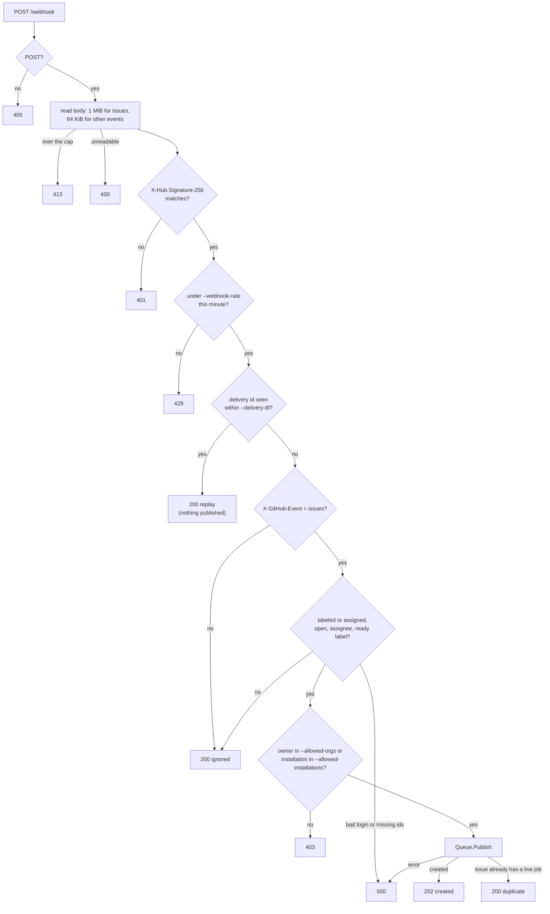
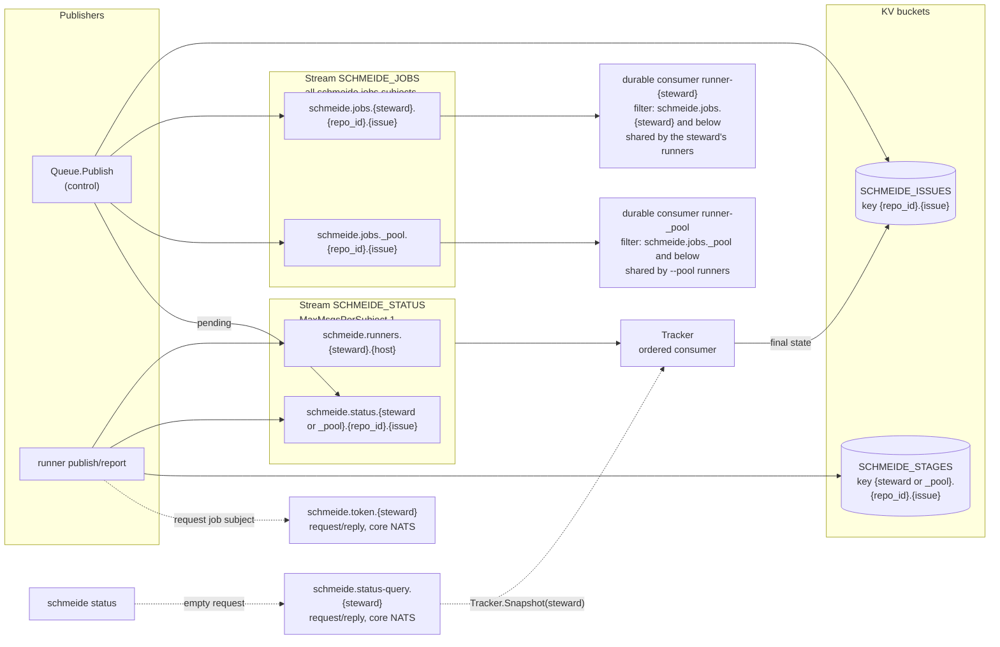

# Control node

`schmeide control` is one process: an HTTP webhook listener and an embedded NATS server with JetStream. It turns
GitHub `issues` webhooks into jobs, holds the queue, records what runners report, and mints a GitHub installation
token for each job a runner asks for. All of it is in `internal/control`.

| File | Owns |
| --- | --- |
| `internal/control/cli.go` | `Main`, `parseControl`, the `controlSettings` table, `--config` file reading, `CheckPrivateKeyFileMode`, `InitConfig` (what `schmeide init` writes) |
| `internal/control/control.go` | `Config`, `Run` (startup order), `Handler` (the `/webhook` endpoint), `WebhookPolicy`, the HTTP server timeouts |
| `internal/control/guard.go` | `webhookGate`: the per-minute rate limit and the delivery-id memory |
| `internal/control/intake.go` | `Job`, `Job.Subject`, `VerifySignature`, `JobFromIssuesEvent`, `Allowlist`, `ParseRunnerTokens`, `Intake.Verify`, `Intake.Handle`, `Outcome` |
| `internal/control/queue.go` | `StartQueue`, `Queue.Publish`, `runnerPermissions`, `ServeTokens`, the job stream, the issue and stage buckets |
| `internal/control/status.go` | `State`, `Status`, `Registration`, `Tracker` (`Queue.Track`), the `SCHMEIDE_STATUS` stream, `Tracker.Snapshot`, `Queue.ServeStatus`, `StatusMain` |
| `internal/control/token.go` | `TokenMinter.Mint`, `ParsePrivateKey`, the App JWT |
| `internal/control/tls.go` | `natsTLSConfig` (cert reload per handshake), `listensBeyondLoopback` |

## Settings

Every setting comes from a flag, a `SCHMEIDE_<NAME>` environment variable, or a `name = value` line in the
`--config` file, in that order of precedence (`parseControl`). The config file is not TOML: blank lines and `#`
lines are skipped, values may be double-quoted, and an unknown name is an error. `schmeide control --help` prints
the table in `controlSettings`.

| Setting | Default | Notes |
| --- | --- | --- |
| `--http-addr` | `:8080` | Plain HTTP webhook listener. |
| `--webhook-rate` | `1000` | Requests per minute. Must be positive. |
| `--delivery-ttl` | `10m` | How long an `X-Github-Delivery` id is remembered. Must be positive. |
| `--nats-addr` | `127.0.0.1:4222` | Runners connect here. |
| `--nats-tls-cert-file`, `--nats-tls-key-file` | none | Both or neither. Required when `--nats-addr` is beyond loopback, unless `--allow-plaintext-nats`. |
| `--allow-plaintext-nats` | `false` | `true` lets NATS listen beyond loopback without TLS, with a warning. |
| `--runner-tokens` | required | `<login>:<token>,...`, one per steward. |
| `--data-dir` | `schmeide-data` | JetStream store directory. The image sets `SCHMEIDE_DATA_DIR=/data`. |
| `--webhook-secret` | required | |
| `--ready-label` | `schmeide:ready` (`DefaultReadyLabel`) | |
| `--allowed-orgs`, `--allowed-installations` | at least one required | `ParseAllowlist` refuses both empty. |
| `--github-app-id`, `--github-app-private-key-file` | required | The key file must not be group- or other-readable. |
| `--github-api-url` | `https://api.github.com` | Used for minting only. |

## Startup

`Run` in `internal/control/control.go` starts things in this order, and any failure stops startup:

1. Parse the allowlist, runner tokens, webhook rate, delivery TTL, and `--allow-plaintext-nats`.
2. Refuse to start (`ErrPlaintextNATS`) when NATS has no TLS, `--nats-addr` is beyond loopback, and
   `--allow-plaintext-nats` is not `true` (`checkNATSTransport`). With it, log a warning instead. Then read and
   parse the App private key (`ParsePrivateKey` accepts PKCS#1 or PKCS#8 RSA).
3. `StartQueue`: start the embedded NATS server, connect in-process as `_schmeide_control` with a random
   password (`rand.Text()`), open the `SCHMEIDE_ISSUES` and `SCHMEIDE_STAGES` buckets and the `SCHMEIDE_JOBS`
   stream (`Queue.openJobs`).
4. `Queue.ServeTokens`: subscribe to `schmeide.token.*`.
5. `Queue.Track`: create or update `SCHMEIDE_STATUS` (which applies its one-message-per-subject limit to a stream
   an older control node created without it), replay what it holds, then follow new messages. Only
   after the replay is `q.tracker` set, so pool routing knows which stewards have runners before the first
   webhook is accepted.
6. `Queue.ServeStatus`: subscribe to `schmeide.status-query.*`.
7. Listen on `--http-addr` and serve `/webhook`.

On SIGINT or SIGTERM the HTTP server gets 10 seconds to finish requests in flight, then the deferred
`Queue.Close` stops NATS.

## Webhook intake

- `Handler` (`control.go`) reads the capped body, then checks the signature (`Intake.Verify`), then the rate
  limit (`webhookGate.allow`), then the replay memory (`webhookGate.replay`), and only then calls
  `Intake.Handle`. The signature comes first so a request without the webhook secret gets a 401 and never uses
  the rate budget or reaches the replay memory: it cannot crowd out genuine deliveries, and it cannot learn
  whether a delivery id was seen. The rate limit comes before the replay check, so repeating a delivery id is
  not a way around the limit; a replay counts as one request. The cost of this order is that an unsigned flood
  is read (up to the body cap below) and hashed before it is rejected.
- The body cap depends on the `X-GitHub-Event` header, which is read first: 1 MiB (`maxIssuesWebhookBytes`) for
  `issues`, 64 KiB (`maxOtherWebhookBytes`) for anything else. GitHub caps an issue body at 65,536 characters, so a
  real `issues` payload is far smaller. The body is read before its signature can be checked, so the cap bounds the
  memory an unsigned request can hold. A body over the cap answers 413 "a <event> payload may be at most <n>
  bytes", is logged as `msg="webhook rejected"` with the event, and publishes nothing.
- A delivery id is remembered only after a successful outcome (`webhookGate.remember`), so a failed delivery
  can be redelivered. An empty id is never a replay. Both the rate limit and the id memory are in memory and
  reset on restart. `Queue.Publish` dedupes across restarts.
- The HTTP server sets `ReadHeaderTimeout` 10s and `ReadTimeout` 30s (`newWebhookServer`).
- `VerifySignature` is an HMAC-SHA256 over the raw body, compared with `hmac.Equal`.
- `JobFromIssuesEvent` builds a `Job` only for actions `labeled` and `assigned` (`jobActions`). Edits and reopens
  never create a job, because only a person with triage access can label or assign. The steward is
  `issue.assignee`, or the first of `issue.assignees`. A login with NATS subject syntax (`.`, `*`, `>`, space) or
  equal to `_pool` is an error.
- The `Job` carries `repo`, `repo_id`, `issue`, `steward`, `pool`, `installation_id`, `title`, and `body`. The
  title and body are the issue as it stood in that delivery.

## Embedded NATS and JetStream

`StartQueue` runs `server.NewServer` with JetStream on, `StoreDir = --data-dir`, one NATS user per steward from
`--runner-tokens` with `runnerPermissions(steward)`, plus the control user, which has no permission limits.
Logging and signal handling of the embedded server are off (`NoLog`, `NoSigs`). There is no NATS account
configuration, so everything is in the default global account.

The server bounds what a steward's token can do to the control node:

- `MaxPayload` is 512 KiB (`maxPayloadBytes`). It applies to every connection, the control node's own included, so
  it must hold the largest job: a 65,536-character issue body whose every character `json.Marshal` escapes to six
  bytes stays under 400 KiB. A runner's client refuses a larger publish with `nats: maximum payload exceeded`.
- `MaxConn` is 16 (`maxConnectionsPerSteward`) per steward in `--runner-tokens`, plus one for the in-process
  connection (`maxConnections`). NATS without operator JWTs has no per-user connection limit, so the stewards share
  that total; a client past it fails with `nats: server maximum connections exceeded`.
- The `SCHMEIDE_STAGES` bucket keeps one revision per key (`History: 1`) and refuses a value over 4 KiB
  (`maxStageValueBytes`). A runner logs a refused stage write as `could not record the job's stage` and goes on.
- `SCHMEIDE_STATUS` has no limits yet; a steward can still grow it (#210).

### Streams, buckets, and subjects

| Name | Kind | Subjects or keys | Written by | Read by |
| --- | --- | --- | --- | --- |
| `SCHMEIDE_JOBS` (`JobStream`) | stream, `MaxMsgs` 100,000 (`jobStreamMaxMsgs`), discard oldest | `schmeide.jobs.<steward>.<repo_id>.<issue>`, `schmeide.jobs._pool.<repo_id>.<issue>` | `Queue.Publish` | runner consumers; `tokenFor` via `GetLastMsgForSubject`; `seedIssues` at startup |
| `SCHMEIDE_STATUS` (`StatusStream`) | stream, `MaxMsgsPerSubject` 1, discard oldest, `AllowDirect` | `schmeide.runners.<steward>.<host>` (`Registration`, `RegisterSubject`; older runners use `schmeide.runners.<steward>`), `schmeide.status.<steward or _pool>.<repo_id>.<issue>` (`Status`) | runners; `Queue.Publish` (`pending` for a new job) | `Tracker` (replay plus ordered consumer), which answers `schmeide status`; runners restoring the attempt count (direct get, own and pool subjects only) |
| `SCHMEIDE_ISSUES` (`issueBucket`) | KV, default config | `<repo_id>.<issue>` → `issueRecord{subject, state, after}` | `Queue.Publish`, `Tracker.finish`, `seedIssues` | `Queue.Publish` dedupe |
| `SCHMEIDE_STAGES` (`StageBucket`) | KV, `History: 1`, `MaxValueSize` 4 KiB | `<steward or _pool>.<repo_id>.<issue>` → runner `stage` record | runners (`Runner.mark`, deleted at a final state) | runners (`Runner.recordedStage`) |
| `schmeide.token.<steward>` (`TokenSubjectPrefix`) | core NATS request/reply | request body is a job subject, reply is `TokenReply` | runners, `schmeide doctor` (empty body as a liveness ping) | `Queue.ServeTokens` |
| `schmeide.status-query.<steward>` (`StatusQuerySubjectPrefix`) | core NATS request/reply | empty request, reply is `StatusReply` (a `Snapshot` scoped to the steward) | `schmeide status` | `Queue.ServeStatus` |

The status stream captures the subjects runners publish on, so publishers do not need JetStream acks for
statuses. It keeps one message per subject: each registration subject names one steward and one host, and each
status subject names one job, and only the latest message on each is ever read (by the replay, and by a
runner's `GetLastMsgForSubject`). The stream therefore grows with the number of jobs and
of steward and host pairs, not with the number of status changes or runner restarts. `Track` applies the limit
with `CreateOrUpdateStream`, so a stream an older control node created without limits is updated on the first
start and its older messages are dropped then.

### Consumers

The control node creates no job consumers. Each runner opens them on `SCHMEIDE_JOBS` at startup
(`Runner.sharedConsumer` in `internal/runner/runner.go`): it calls `CreateConsumer`, and when the consumer
already exists (`jetstream.ErrConsumerExists`) it uses it as it is with `js.Consumer`.

- `runner-<steward>` (`ConsumerName`), filter `schmeide.jobs.<steward>.>` (`JobFilter`), explicit ack, `AckWait`
  from the runner's `--ack-wait`. All of one steward's runners share it, so each job is delivered to one of them.
- `runner-_pool`, filter `schmeide.jobs._pool.>`, created only by a runner started with `--pool`. All pool runners
  share it.

Because the consumer is shared, the first runner to create it sets its `AckWait`, and a later runner with a
different `--ack-wait` does not change it. That runner logs `a shared job consumer already has another ack
wait; heartbeating at the consumer's` and sends `InProgress` every third of the consumer's `AckWait` (the
shorter one, for a `--pool` runner with two consumers). To change `AckWait`, delete the consumer with the
`nats` CLI while no runner is working a job from it; the next runner to start creates it again.

No `MaxDeliver` is set, so JetStream redelivers without limit. The runner's own attempt count
(see [Runner](runner.md#retries-and-acknowledgment)) is what ends retries. `MaxDeliver` would count every
delivery, including a hand-back when a token could not be minted, a hand-back at shutdown, and a redelivery
after a runner died, which the attempt count deliberately does not count. A job that reached `MaxDeliver` would
stop being delivered with no status and no issue comment.

### Runner permissions

`runnerPermissions(steward)` in `queue.go` lets a steward's NATS user publish only to:

- consumer create, info, next, and ack for `runner-<steward>` with exactly its own filter, and the same for
  `runner-_pool` with the pool filter;
- `schmeide.runners.<steward>`, `schmeide.runners.<steward>.*`, `schmeide.status.<steward>.>`, and
  `schmeide.status._pool.>`;
- `schmeide.token.<steward>` and `schmeide.status-query.<steward>`;
- stream info on `SCHMEIDE_STATUS`, and direct get on `schmeide.status.<steward>.>` and `schmeide.status._pool.>`
  in it, which a runner uses to restore a job's attempt count. There is no plain message get and no direct get on
  another steward's statuses or on any registration;
- put and direct get on `$KV.SCHMEIDE_STAGES.<steward>.>` and `$KV.SCHMEIDE_STAGES._pool.>`, and stream info on
  `KV_SCHMEIDE_STAGES`.

It may subscribe only below `_INBOX_<steward>.>` (`InboxPrefix`). Runners and `schmeide status` connect with
`nats.CustomInboxPrefix(InboxPrefix(steward))`, so one steward cannot read another steward's token replies.

## Publishing a job

`Queue.Publish` decides where the job goes and whether it is new.

1. `job.Pool` is set when the tracker is running and `Tracker.hasRunner(steward)` is false: the steward has no
   live registration, one stored within `RegistrationTTL` (3 minutes). A steward whose runner stopped, or never
   refreshed its registration, gets its next job on the pool subject. Until `Track` has run there is no tracker and
   the job stays on the steward's subject.
2. The issue key is `<repo_id>.<issue>`. When a record exists and its state is not `gate_failed` or `failed`
   (`State.failure`), the delivery is a duplicate: an unfinished job, or one that ended with a pull request
   (`pr_opened`, `review_failed`, `merged`, `queued`, `merge_failed`), blocks a new job for that issue whoever
   the steward is. A job that ended `gate_failed` or `failed` is replaced, so relabeling the issue makes a new job.
3. The new `issueRecord` holds the job subject and `After`, the last `SCHMEIDE_STATUS` sequence at publish time.
   Only statuses stored after `After` can finish this job, which keeps an earlier job's final status for the same
   subject from closing the new one.
4. The record is written with `Create` (no record) or `Update` at the read revision. Of two concurrent deliveries
   for one issue, one wins and the other reports duplicate.
5. `publishPending` stores `Status{state: "pending"}` on the job's status subject
   (`schmeide.status.<steward or _pool>.<repo_id>.<issue>`), so `schmeide status` lists the job before a runner
   claims it. It runs only once the tracker is running (the stream exists then), and only on this new-job path, so
   a duplicate delivery stores no second `pending` and does not reset the wait. It runs before the job is
   published, so a runner's `claimed` always gets a later sequence and supersedes it. A failure here is logged at
   warn (`could not record the job as pending; schmeide status will not list it until a runner claims it`) and the
   job is still created.
6. The job is published to JetStream. If that fails the record is rolled back and the `pending` status is
   deleted from `SCHMEIDE_STATUS` by sequence, so no pending line is left for a job that was never stored.

On startup `seedIssues` copies every job still in the stream into the issue bucket when its key is missing, and
only then is `MaxMsgs` applied to the stream. That keeps upgrades from older control nodes, where the stream was
the only dedupe record, from losing dedupe when the stream starts discarding.

## Runner registration and status

A runner publishes a `Registration{steward, harnesses, host, pool, version}` on
`schmeide.runners.<steward>.<host>` (`RegisterSubject`) at startup and flushes, and is expected to publish it
again every `RegistrationInterval` (1 minute) while it runs. In the host token, `.`, `*`, `>`, and white space
become `_`, and an empty host is `_`. It then publishes a `Status{state, detail, attempts}` on its job's status
subject at every state change. The control node publishes one `pending` status on that subject when it creates
the job (see Publishing a job above); every runner state supersedes it, and the stream's one-message-per-subject
limit removes it. When the job's publish fails after the `pending` status was stored, `Queue.Publish` deletes
that message and `Tracker.forget` drops it, whether or not the tracker has seen it yet.

A registration is live for `RegistrationTTL` (3 minutes, three intervals) after JetStream stored it. The age comes
from the stored message's timestamp, not from when the tracker saw it, so a control node restart does not refresh
a stale registration. `Tracker.live` drops registrations past the TTL on each read; `hasRunner`, `poolRunner`
(pool routing and pool token minting), `Runners`, and the `schmeide status` snapshot see only live ones. Nothing is
logged when a registration expires.

`Tracker` (`status.go`) keeps the registrations and the latest status per job in memory:

- `observeRegistration` drops a registration whose payload steward and host do not match the subject
  (`RegisterSubject(steward, host)`, or `schmeide.runners.<steward>` from an older runner), since only the
  subject is pinned by NATS permissions. It keeps one entry per (steward, host), the latest, with the time it was
  stored. Every registration, a refresh included, logs `msg="runner registered"`, and a warning when
  `release.Skewed(runner version, control version)`; the runner is still accepted.
- `observeStatus` stores the status and the time the message was stored on the stream (`since`), and, for a
  final state (`State.final`: `pr_opened`, `review_failed`,
  `merged`, `queued`, `merge_failed`, `gate_failed`, `failed`), calls `Tracker.finish`, which writes the state
  into the issue record when the record still names that subject, is not already finished, and the status
  sequence is after `After`.

After a restart, `Track` replays `SCHMEIDE_STATUS` from its first sequence before it sets `q.tracker`, so the
registrations, latest states, and issue-record final states are rebuilt before any new webhook is published.
Sequences the per-subject limit removed are skipped (`jetstream.ErrMsgNotFound`). The ordered consumer starts at
the sequence after the replay, so no message is applied twice.

Because only the latest message per subject is kept, a status can be replaced before the live ordered consumer
reads it. The tracker then applies the newer one instead. This only matters for a final state followed at once
by another status on the same subject: `pr_opened` followed by `reviewing` skips recording `pr_opened` on the
issue record, and the later `merged`, `queued`, `merge_failed`, or `review_failed` records the final state. A
malformed message on a job's status subject replaces that job's stored status; only a runner holding that
steward's token can publish there.

`SCHMEIDE_STATUS` has `AllowDirect` set, so a direct get names the subject in the request subject and NATS
permissions can limit it to the steward's own and pool job statuses.

`schmeide status` (`StatusMain`) connects as a steward and sends an empty request on
`schmeide.status-query.<steward>` (`StatusQuerySubjectPrefix`). `Queue.ServeStatus`, started by `Run` right after
`Track`, answers with a `StatusReply`: `Tracker.Snapshot(steward)`, which holds the steward's live registrations and
every job on `schmeide.jobs.<steward>.` whose latest state is not final, plus jobs on `schmeide.jobs._pool.` when
the steward has a live pool registration (`poolRunner`). Each job's `JobState.Since` is the stored time of its
latest status; the text output prints the time since then in the FOR column, which for a `pending` job is how
long it has waited. The subject's steward token is pinned by NATS permissions,
so a steward can only ask about itself. `--json` prints the `Snapshot` struct, whose JSON form is stable (`since` was added for #238). When no
control node answers (`nats.ErrNoResponders`, an older control node), `schmeide status` exits 1 with "the control
node does not answer status queries; upgrade `schmeide control` to this version".

A job a runner hands back (`NakWithDelay` after a failed token request, `Nak` for a stuck job or on shutdown)
keeps the runner's last state, usually `claimed` or `working`, until the next runner reports on it. That is
accepted: the control node does not see a `Nak`, and the next delivery reports `claimed` again within the retry
delay. A job pushed out of `SCHMEIDE_JOBS` by `MaxMsgs` while still unclaimed would keep a stale `pending`; with
100,000 messages before that happens, it is not handled.

### Job states

| State | Final | Meaning |
| --- | --- | --- |
| `pending` | no | The control node created the job; no runner has reported on it yet. |
| `claimed` | no | A runner received the delivery. |
| `working` | no | A writer session is running (detail: harness name). |
| `retrying` | no | A work attempt failed and the job was handed back. |
| `reviewing` | no | A reviewer round started (detail: `round N of M`). |
| `gate_failed` | yes, failure | The gate failed or timed out before the pull request opened, or on a fix round. |
| `failed` | yes, failure | Work failed `--max-attempts` times. |
| `pr_opened` | yes | Review passed, or an earlier attempt's pull request was found closed. |
| `review_failed` | yes | Review rejected with `review_fix` off, rounds ran out, or a post-PR step failed. |
| `merged`, `queued` | yes | Factory merge merged, or enqueued in the merge queue. |
| `merge_failed` | yes | Factory merge did not land. |

## Token minting

`ServeTokens` answers `schmeide.token.*`. `Queue.tokenFor`:

1. Rejects a subject with wildcards or spaces.
2. Accepts only `schmeide.jobs.<steward>.…` (the asker's own job) or `schmeide.jobs._pool.…`.
3. Loads the job from `SCHMEIDE_JOBS` by subject. A subject not in the stream gets no token.
4. For a pool job, requires `job.Pool`, a matching subject, and that the asker has a registration with
   `pool: true` (`Tracker.poolRunner`). For an own job, requires `job.Steward == steward`.
5. Calls `TokenMinter.Mint`, which signs an RS256 JWT (`iss` = App ID, `iat` one minute back, `exp` nine minutes
   ahead) and posts to `/app/installations/<installation_id>/access_tokens` with `repository_ids: [repo_id]` and
   permissions `contents: write`, `pull_requests: write`, `issues: write`, `checks: read`, `administration: read`,
   `actions: read`.

The reply is a `TokenReply`, with `error` set instead of a token on any refusal. See
[Credentials](credentials.md) for scope and lifetime.

## Heartbeat lease and stuck jobs

Both are runner flags that act on the JetStream delivery, not control node flags:

- `--ack-wait` (default 5m) becomes the consumer's `AckWait` when this runner creates the consumer. The runner
  sends `InProgress` every third of the consumer's `AckWait`, whichever runner set it.
  When the heartbeats stop, JetStream redelivers the job to another runner on the same consumer.
- `--stuck-after` (default 3h) is a runner-side watchdog. Each state the runner reports resets it. When it fires,
  the runner cancels the job's work and `Nak`s the delivery.

The mechanism is drawn in [Job flows](job-flows.md#d-a-runner-killed-mid-job) and the policy is in
[FAILURE-MODES.md](../FAILURE-MODES.md#delivery-heartbeats-and-stuck-jobs).

## TLS on NATS

With both `--nats-tls-cert-file` and `--nats-tls-key-file`, `natsTLSConfig` loads the pair once (a bad pair fails
startup), sets TLS 1.2 minimum, and installs a `GetCertificate` that reloads both files on every handshake. A
failed reload, such as a half-written renewal, serves the last pair that loaded. The in-process control
connection never uses TLS. Runners verify the certificate against the system roots; there is no client
certificate. Setting only one of the two files is a startup error.

Without the pair, `checkNATSTransport` (in `internal/control/tls.go`) refuses a `--nats-addr` that
`listensBeyondLoopback` reports as reachable from another machine: any host that is not a loopback IP or
`localhost`, including an empty host (`:4222`). `Run` returns `ErrPlaintextNATS` before it reads the App key or
touches the data directory, and `schmeide control` exits 1. `--allow-plaintext-nats true` skips the refusal; the
control node then logs `NATS listens beyond loopback without TLS because --allow-plaintext-nats is set; steward
tokens and job tokens cross the network in plain text. Set --nats-tls-cert-file and --nats-tls-key-file` at WARN.
