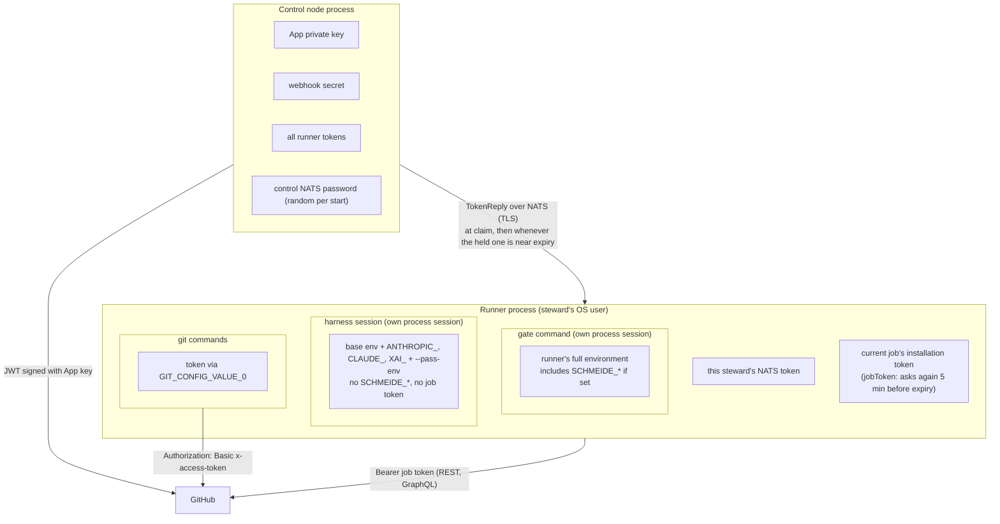
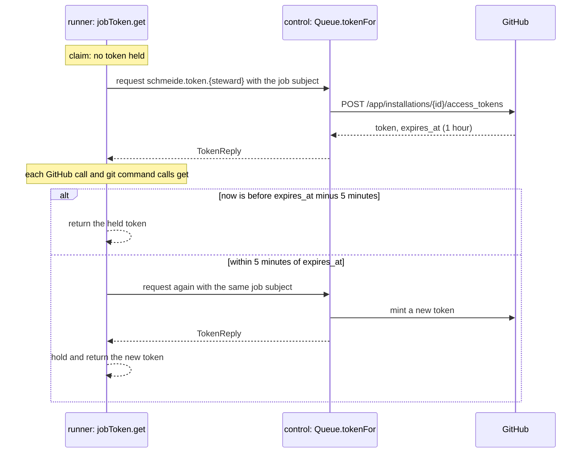

# Credentials

This page lists every secret schmeide handles, who holds it, how far it reaches, and which process can see it.
The design rule is that a runner holds no long-lived GitHub credential and schmeide never handles agent keys.

## Trust boundaries

| Boundary | What crosses it | What is kept out |
| --- | --- | --- |
| GitHub to control node | signed webhook payloads | anything without a valid `X-Hub-Signature-256` |
| Control node to runner | job messages, a token for each of the steward's own jobs (and pool jobs for a `--pool` runner) | the App key, the webhook secret, other stewards' jobs, tokens, and stage records |
| Runner to harness session | the brief, the worktree, the reduced environment | the job's installation token, the NATS token, `SCHMEIDE_*` settings |
| Runner to gate | the worktree and the runner's environment | the job's installation token (it is only in git's environment) |
| Worktree to remote | tracked files that pass the secret scan | credential-shaped literals |

The session and the gate run as the runner's OS user, with that user's files. There is no container or OS
sandbox. [FAILURE-MODES.md](../FAILURE-MODES.md#not-built) and [design.md](../design.md#open-decisions) say so.

## GitHub App installation tokens

| Aspect | Value |
| --- | --- |
| Minted by | `control.TokenMinter.Mint` (`internal/control/token.go`) |
| Authenticated as | the App, with an RS256 JWT: `iss` App ID, `iat` now minus 1 minute, `exp` now plus 9 minutes |
| Endpoint | `POST <github-api-url>/app/installations/<installation_id>/access_tokens` |
| Repository scope | `repository_ids: [job.repo_id]`, the one repository |
| Permissions requested | `contents: write`, `pull_requests: write`, `issues: write`, `checks: read` |
| Lifetime | one hour, set by GitHub. The first token of a delivery is requested at claim time; the runner asks for another whenever the one it holds is within five minutes of its `expires_at`. |
| Who may ask | a runner on `schmeide.token.<steward>`, for a subject in `SCHMEIDE_JOBS` that is that steward's job, or a pool job when the steward registered with `--pool` (`Queue.tokenFor`) |
| Where the runner keeps it | in memory only, in the job's `jobToken` (`internal/runner/token.go`); `forge.GitHub.Tokens` and every git command read it from there |

How the runner uses it:

- Git: `worktree.git` (`internal/runner/workspace.go`) asks the job's token source for the current token and sets
  `GIT_CONFIG_COUNT=1`, `GIT_CONFIG_KEY_0=http.extraHeader`, and
  `GIT_CONFIG_VALUE_0=Authorization: Basic base64(x-access-token:<token>)` in the environment of each git command
  it runs. The token is never written to git config or put on a command line. `GIT_TERMINAL_PROMPT=0` stops a
  credential prompt.
- REST and GraphQL: `Authorization: Bearer <token>`, built by `forge.GitHub.Bearer` before each call from
  `forge.GitHub.Tokens` (`internal/forge/github.go`, `internal/forge/queue.go`, and `RetargetPull` in
  `internal/runner/github.go`).

### Refreshing a job's token

A job can run longer than a token lives: the default `session_timeout` alone is two hours, and review rounds and
`check_wait` come after it. So the runner never holds one token for a whole job.

- `Runner.handle` builds one `jobToken` per delivery (`internal/runner/token.go`). Its `fetch` is the same
  `schmeide.token.<steward>` request the claim makes. `get` holds a mutex, so concurrent calls refresh once.
- `stale` decides: no token yet, or `now` at or after `expires_at` minus `tokenRefreshMargin` (five minutes). A
  token without an `expires_at` is never refreshed.
- `Queue.tokenFor` (`internal/control/queue.go`) mints a new token on every request whose subject is still in
  `SCHMEIDE_JOBS` and belongs to the asking steward (or is a pool job it may take). The job stays in the stream
  while it is worked and after it is acknowledged (the stream has limits retention), so a refresh at any point of
  the job, including the outcome comment, is answered. Each refresh is one more token minted by the App.
- A refresh that fails returns `refresh the job's GitHub token: <cause>` and keeps the old token, so the next call
  tries again. The GitHub call or git command that needed it fails with that error and the job fails the way any
  GitHub error fails it. The outcome comment is still attempted after that, with its own refresh. When that one
  fails too, the runner logs `level=ERROR msg="could not comment on the issue"` with the refresh error and
  acknowledges the job; the job's state is still reported on `SCHMEIDE_STATUS`, so `schmeide status` shows it.

The four permissions do not include `administration` or `actions`. Reading branch protection needs
Administration read, and `forge.GitHub.Protection` treats the resulting 403 as no protection. Reading an Actions
job log for a CI fix round needs Actions read; when that read fails, `logTail` puts "(schmeide could not read the
log ...)" in the fix brief in place of the log.

## Per-steward NATS tokens

`--runner-tokens` on the control node is `<login>:<token>,...`. `ParseRunnerTokens` refuses an empty list, a
duplicate steward, a steward with subject syntax or `/` or `\`, and `_pool`. Each entry becomes a NATS user named
after the steward with the token as its password and `runnerPermissions(steward)` as its permissions (see
[Control node](control-node.md#runner-permissions)). A runner, `schmeide status`, and `schmeide doctor` pass the
same pair as `--steward` and `--nats-token`.

What a stolen steward token gives: that steward's jobs (including issue text), its token subject (and so
installation tokens for its jobs' repositories), its stage records, pool jobs and their stage records, and read
access to every registration and status on `SCHMEIDE_STATUS`. It does not give other stewards' jobs, tokens, or
replies. Token rotation is a control node restart with a new `--runner-tokens`.

The control node's own connection is in-process, as `_schmeide_control` with a password from `rand.Text()` that
is never written anywhere.

Prefer `SCHMEIDE_RUNNER_TOKENS` and `SCHMEIDE_NATS_TOKEN` (or the `--config` file) over flags, so the tokens stay
out of the process list. The flag help says the same.

## Webhook secret

`--webhook-secret` (`SCHMEIDE_WEBHOOK_SECRET`) is the App's webhook secret. `VerifySignature` computes
HMAC-SHA256 of the raw body and compares it with `hmac.Equal` against the `sha256=` header. A bad or missing
signature is a 401 before anything in the body is trusted. The allowlist (`--allowed-orgs`,
`--allowed-installations`) is a second check after the signature, so a valid delivery from an installation
outside the list is a 403 when it would create a job.

## App private key file

`--github-app-private-key-file` names a PEM file holding a PKCS#1 or PKCS#8 RSA key. `CheckPrivateKeyFileMode`
refuses to start when the mode has any group or other read bit (`mode & 0o044`). The key is read once in
`control.Run` and kept in memory for JWT signing. It never leaves the control node.

## Harness session environment

`harnessEnv` in `internal/runner/env.go` filters the runner's `os.Environ()`:

| Kept | Names |
| --- | --- |
| base names (`baseEnv`) | `PATH`, `HOME`, `USER`, `LOGNAME`, `SHELL`, `TERM`, `LANG`, `TZ`, `TMPDIR`, `HTTP_PROXY`, `HTTPS_PROXY`, `NO_PROXY`, `http_proxy`, `https_proxy`, `no_proxy`, `SSL_CERT_FILE`, `SSL_CERT_DIR` |
| base prefixes (`basePrefixes`) | `LC_*`, `XDG_*` |
| harness prefixes (`harnessPrefixes`) | `ANTHROPIC_*`, `CLAUDE_*`, `XAI_*`: the harness's own login and settings |
| `--pass-env` | each listed name, exactly. The help text says never to list a secret. |
| added by the runner | `GOCACHE`, `GOMODCACHE`, `GOFLAGS` (existing value plus `-modcacherw`) |

Everything else is dropped, including every `SCHMEIDE_*` variable, so a session cannot read the steward's NATS
token from its environment. The job's installation token is never in the session's environment either: it lives
only in the git commands' environment. A session can still read any file the runner's OS user can read, including
the harness's own login under `HOME`.

### The gate inherits the runner's environment

`runner.work` creates the worktree without an env list, so `worktreeSpec.env` is nil and `worktree.Run` falls
back to `os.Environ()` for the gate. The gate therefore sees the runner's whole environment, including
`SCHMEIDE_NATS_TOKEN` when the token was passed that way, and any agent API keys. The gate is a command from the
repository's base branch, but it runs code the session just wrote (tests, build scripts), so a session can reach
the runner's environment through the gate. This is a known gap (#111). The comment on `baseEnv` in `env.go` says the
base list does not apply to the gate. Until the gate gets a filtered environment, run the runner as a user that
holds nothing else worth taking, and pass the NATS token in a way the gate cannot read if that matters.

Git commands get only the token and identity variables (`GIT_TERMINAL_PROMPT`, `GIT_CONFIG_*`, `GIT_AUTHOR_*`,
`GIT_COMMITTER_*`), with no `PATH` or `HOME`.

## Harness permission flags

`--claude-args` and `--grok-args` default to `--permission-mode acceptEdits`, which lets a session edit files in
its worktree. `harnessFlags.check` in `internal/runner/cli.go` refuses to start when either contains
`--dangerously-skip-permissions`, `--allow-dangerously-skip-permissions`, or a `--permission-mode` other than
`acceptEdits` (`harness.WideningArg`), unless `--allow-dangerous-harness-args` is set. `--claude-args` reaches only
the Claude Code harness and `--grok-args` only Grok. Details and the opt-in are in
[permissions.md](../permissions.md).

## TLS material

`--nats-tls-cert-file` and `--nats-tls-key-file` are read by `natsTLSConfig` at startup (a bad pair fails startup)
and again on every TLS handshake, so a renewed certificate is served without a restart. A failed reload keeps the
last good pair. Runners verify the server certificate against the system roots (`SSL_CERT_FILE` for a private CA
on Linux). There are no client certificates; the steward token is the client credential, which is why NATS
beyond loopback without TLS logs a warning. The webhook listener has no TLS of its own and relies on the proxy in
front of it.

## Secret scan before push

`secretscan.Scan` runs before every `git push` from `Workspace.Push` and `Workspace.Restack`. It lists tracked
files with the real git binary and a minimal environment (`PATH` and `GIT_CONFIG_GLOBAL=/dev/null`), so the scan
neither hands the runner's secrets to git nor reads the process environment. It matches:

| Kind | Pattern |
| --- | --- |
| PEM private key | `-----BEGIN ... PRIVATE KEY-----` |
| GitHub token | `ghp_` plus 36, or `github_pat_` plus 20 or more |
| GitLab token | `glpat-` plus 20 or more |
| AWS access key | `AKIA` plus 16 |
| JWT | `eyJ` and three base64url segments of 8 or more |

A line containing `schmeide:allow-secret` is skipped. A finding refuses the push and names file, line, and kind,
never the text. The refusal is a failed work outcome. The scan covers every tracked file, so a repository that
already contains a matching literal without the marker cannot be pushed to by the factory. `.gitguardian.yaml` lists the same
shapes in a comment for the GitGuardian scan on the schmeide repository itself.

## Trust prompt

The trust prompt is a guard against running sessions and gates for an origin nobody agreed to, not a credential.
It is described in [Runner](runner.md#trust-prompt). `SCHMEIDE_TRUST=1` disables it for one process.
