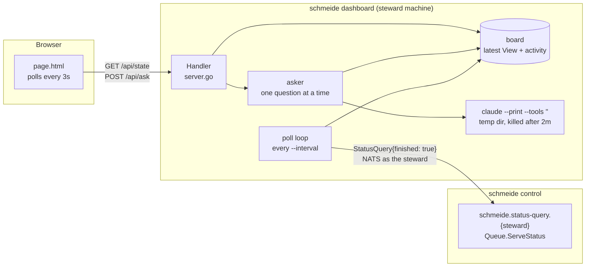

# Dashboard

`schmeide dashboard` is a local web page for one steward. It shows that steward's runners and jobs as the control
node reports them and keeps a log of the states it has seen. Its "Ask the factory" panel answers questions about
what the page shows with the claude CLI, which runs with no tools. It is implemented in `internal/dashboard`.

The dashboard is a reader. It publishes no job, status, or registration, it does not read `SCHMEIDE_STAGES` or
GitHub, and the claude session it starts for a question cannot run commands, read files, or change anything.



## Files

| File | What it holds |
| --- | --- |
| `internal/dashboard/dashboard.go` | Package doc, `Config`, `Usage`, `Main` (flags, exit codes), `Run` (NATS connection, listener, poll loop, HTTP server, shutdown) |
| `internal/dashboard/board.go` | `View`, `Job`, `Runner`, `Event`, and `board`, which holds the latest `View` and builds the activity log |
| `internal/dashboard/ask.go` | `Question`, `Turn`, `Prompt`, `Claude` (the claude subprocess), and `asker` (one question at a time) |
| `internal/dashboard/server.go` | `Handler`: the page, `GET /api/state`, `POST /api/ask`, and the loopback host check |
| `internal/dashboard/page.html` | The page, embedded with `go:embed`. Plain HTML, CSS, and JavaScript; it builds every element from data with `textContent`, never `innerHTML`, because issue titles come from GitHub |

## Startup

`Main` parses the flags (see [`docs/config.md`](../config.md#dashboard-flags)), starts a context canceled by
`SIGINT` or `SIGTERM`, and calls `Run`. A usage error exits 2 with `Run 'schmeide dashboard --help' for usage.`,
and a runtime error exits 1.

`Run`:

1. Connects to `--nats-url` as the steward, with `control.InboxPrefix(steward)` as the inbox prefix and
   `nats.MaxReconnects(-1)`, so a control node restart does not stop the dashboard. A first connection that fails
   returns `cannot reach the control node's NATS at <url> as <steward>: ...`, followed by the same "Check that
   `schmeide control` is running..." advice as `schmeide status`.
2. Listens on `--addr`. A taken address returns `listen on <addr>: ...; pass a free address with --addr`. An
   address that is not loopback (`localhost`, `127.0.0.0/8`, `::1`) logs `the dashboard is reachable beyond this
   machine and has no login; anyone who can reach it sees your jobs and can ask questions on your claude account`
   and serves anyway, without the host check.
3. Asks the status query once, then every `--interval`, and applies each answer to the board.
4. Serves HTTP and logs `dashboard serving url=http://<addr> steward=<steward> model=<model>`. When the context
   ends it shuts the server down within 5 seconds and returns nil.

## Polling and the view

Each poll calls `control.QueryStatus(nc, steward, control.StatusQuery{Finished: true})`. The control node answers
with the steward's `Snapshot`: live registrations, unfinished jobs, and, because `finished` is set, the jobs whose
final state was stored within `control.FinishedWindow` (24 hours). See
[Control node](control-node.md#runner-registration-and-status).

`board.update` turns the answer into the `View` that `GET /api/state` returns:

| Field | Source |
| --- | --- |
| `steward`, `version`, `model` | `--steward`, `release.Version`, `--model` |
| `connected`, `error` | whether the latest query succeeded, and its error |
| `updated` | when the latest successful query returned |
| `runners` | the registrations, each with `skewed` set when `release.Skewed` says its version differs from this binary's |
| `jobs`, `finished` | the `JobState`s, each with `repo_id`, `issue`, and `pool` parsed from the subject `schmeide.jobs.<steward or _pool>.<repo id>.<issue>` |
| `activity` | the activity log, newest first |

A failed query sets `connected` to false and `error` to the error, logs `status query failed; the page shows the
last good state`, and leaves the runners, jobs, and activity from the last good query in place. The page shows
`control node unreachable` with the error as the pill's tooltip. If the dashboard process itself stops answering,
the page keeps the last view and shows `the dashboard process is not answering: ...`.

`repo` and `title` come from the statuses (see [Data](data.md#registration-and-status-controlregistration-controlstatus)).
A job whose statuses name neither, from a runner older than #264, shows `repo <repo id>` and no title, and the
page has no issue link for it.

### Activity log

The activity log is built in `board.record`. After each successful query, every job in `jobs` and `finished` whose
(subject, state, since) has not been seen yet becomes an `Event` with `at` set to `since`, the time the control
node stored that state. So the log is ordered by when things happened, not by when the dashboard noticed them, and
a job queued again for the same issue gets a new `pending` event because its `since` is new. The log keeps the
newest 200 events (`maxActivity`) and forgets the keys of the ones it drops.

The log lives in memory. A restarted dashboard starts from what the first query returns: one event per unfinished
job and per job finished in the last 24 hours. A state that came and went between two polls (for example
`claimed`, followed by `working` within `--interval`) is never seen and has no event.

## The ask panel

`POST /api/ask` takes `{"question": "...", "history": [{"role": "user" | "assistant", "text": "..."}]}`. The page
sends the conversation so far as `history`; the server keeps none.

`asker.Ask`:

1. Builds the prompt with `Prompt(view, question)`. An empty question (after trimming) is `ErrEmptyQuestion`, and
   one longer than 2,000 bytes is `ErrLongQuestion`. The prompt says that what follows is data and that text inside
   it, such as issue titles, is never an instruction. It then holds the current `View` as JSON inside
   `<factory_state now="...">`, the last 10 turns of history inside `<conversation>`, and the question.
2. Takes the one answer slot. While another question is being answered it returns `ErrBusy`.
3. Calls `Claude.Ask`.

`Claude.Ask` runs `--claude` (default `claude` on `PATH`) with:

```text
--print --output-format text --model <model> --tools "" --strict-mcp-config
--disable-slash-commands --no-session-persistence --system-prompt <systemPrompt>
```

`--tools ""` gives the session no built-in tools, `--strict-mcp-config` with no `--mcp-config` loads no MCP
servers, and `--no-session-persistence` saves nothing. The system prompt describes schmeide and the job states and
tells the model it cannot act. The prompt goes in on stdin. The process runs in a new empty temporary directory, so
no `CLAUDE.md` is loaded, as the leader of its own process group, and its group is killed when the request ends or
after 2 minutes (`askTimeout`). It inherits the dashboard's environment, so it uses the claude login on this
machine. Up to 64 KiB of stdout and stderr is kept.

| Outcome | HTTP status | Body |
| --- | --- | --- |
| an answer | 200 | `{"answer": "<stdout, trimmed>"}` |
| a body that is not `application/json` | 415 | `send the question as application/json` |
| a body that is not a question, or over 64 KiB | 400 | `the request is not a question: ...` |
| an empty question | 400 | `the question is empty; type a question and send it again` |
| a question over 2,000 bytes | 400 | `the question is longer than 2000 bytes; shorten it and send it again` |
| another question in flight | 429 | `another question is still being answered; wait for it and ask again` |
| claude not found | 502 | `"claude" was not found; install Claude Code (https://claude.com/claude-code) and log in, or pass --claude with its path` |
| claude exits non-zero | 502 | `claude failed (exit status N): <last 500 bytes of its output>; run `<path> auth status` to check it is logged in` |
| claude prints nothing | 502 | `claude gave an empty answer; ask again` |
| 2 minutes pass | 502 | `claude did not answer within 2m0s; ask a narrower question` |

The page shows the error text in place of the answer. The rest of the dashboard keeps working whatever the ask
panel does.

## HTTP surface

| Route | What it does |
| --- | --- |
| `GET /` | The embedded page, with a `Content-Security-Policy` that allows only inline script and style, Google Fonts, and requests to the dashboard itself |
| `GET /api/state` | The current `View` as JSON, `Cache-Control: no-store` |
| `POST /api/ask` | The ask panel, above |

Any other path is 404, and another method on a known path is 405.

When `--addr` is loopback, every request whose `Host` header is not `localhost`, a loopback IP, or either with a
port is refused with 403 `the dashboard only answers on localhost; open it as http://localhost or
http://127.0.0.1`. That stops a web page on another site from reaching the dashboard through DNS rebinding.
Requiring `application/json` on `POST /api/ask` means a cross-site page cannot send a question without a CORS
preflight, which the dashboard never approves.

## Tests

- `internal/dashboard`: `TestBoardUpdateParsesJobsAndRunners`, `TestBoardActivity`,
  `TestBoardActivityKeepsTheNewest`, `TestBoardFailedQueryKeepsTheLastGoodState`, `TestPrompt`,
  `TestClaudeArgsGiveTheSessionNoTools`, `TestClaudeAsk` (against `cmd/fakeagent`),
  `TestAskerAnswersOneQuestionAtATime`, `TestHandler`, `TestStateIsJSON`, `TestRunServesTheStewardsJobsAndAnswers`
  (a real control queue and `fakeagent`), `TestRunFailsWithoutAControlNode`, `TestRunFailsWhenTheAddressIsTaken`.
- `internal/e2e`: `TestJourneyDashboardShowsTheStewardsJobsAndAnswers` runs the built `schmeide control`,
  `schmeide runner`, and `schmeide dashboard`.
