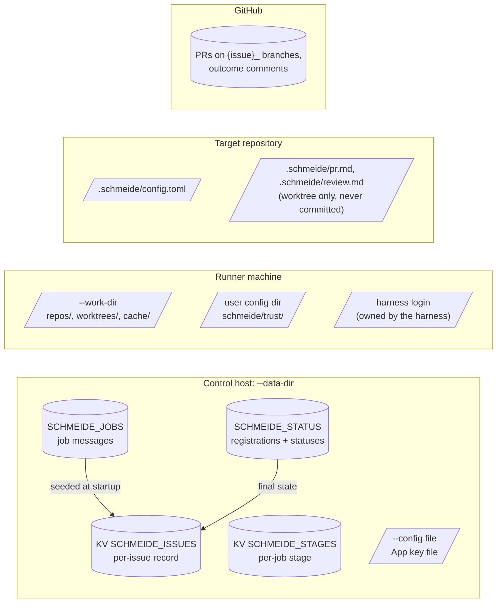

# Data

schmeide has no SQL database. Everything the factory must remember lives in the control node's JetStream store,
on the runner machine's disk, or in the target repository. GitHub (issues, branches, pull requests, comments) is
the record people read, and the runner reads some of it back to decide where a redelivered job resumes.

## Where state lives



## Stores

| Store | Owner (writes) | Readers | Lifetime |
| --- | --- | --- | --- |
| `SCHMEIDE_JOBS` stream | `control.Queue.Publish` | runner consumers, `tokenFor`, `seedIssues` | Until 100,000 later jobs push it out (`MaxMsgs`, discard oldest). Acked jobs are not removed: the stream has the default limits retention. |
| `SCHMEIDE_STATUS` stream | runners (registration, status) | `control.Tracker` (which answers `schmeide status` queries), runners (attempt count, by direct get on their own and pool job subjects) | Unbounded. Every registration and status since the data directory was created. |
| `SCHMEIDE_ISSUES` KV | `Queue.Publish`, `Tracker.finish`, `seedIssues` | `Queue.Publish` | Forever, one key per issue ever made a job. Overwritten when a failed job's issue gets a new job. |
| `SCHMEIDE_STAGES` KV | runners (`Runner.mark`) | runners (`Runner.recordedStage`) | From `worktree_ready` until the job's final outcome, when the runner deletes it. One revision per key (`History: 1`); a value over 4 KiB (`maxStageValueBytes`) is refused. |
| Job consumers `runner-<steward>`, `runner-_pool` | runners (`CreateOrUpdateConsumer`) | JetStream | Durable, in `--data-dir`, until deleted by hand. |
| `--work-dir` bare clones | runner (`newWorktree`) | runner | Until the operator deletes the directory. |
| `--work-dir` worktrees | runner | runner, harness, gate | One job attempt. Removed by `Workspace.Close`. A leftover is replaced on the next attempt. |
| `--work-dir/cache/<repo_id>` | gate and sessions (`GOCACHE`, `GOMODCACHE`) | gate and sessions | Until the operator deletes the directory. |
| Trust records | `trust.Check` | `trust.Check` | Forever, one file per (work dir, origin). |
| Control `--config` file | operator (`schmeide init` writes a template) | `control.parseControl` | Operator-managed. Read once at startup. |
| `.schmeide/config.toml` | repository maintainers | `repoconfig.Load` in the runner, on the base branch | Versioned with the repository. |
| `.schmeide/pr.md`, `.schmeide/review.md` | harness sessions | runner (`prText`, `readVerdict`) | One session. Deleted before the next commit. |
| Logs | control node and runner, `log/slog` text to stderr | operator | Whatever the process supervisor keeps. |

## What survives a control node restart

All of `--data-dir` survives, and `Run` rebuilds the in-memory state from it before the webhook listener opens:

| State | Survives | How |
| --- | --- | --- |
| Queued and in-flight jobs | yes | `SCHMEIDE_JOBS` and the durable consumers. A held job is redelivered when its lease lapses. |
| Per-issue dedupe | yes | `SCHMEIDE_ISSUES`. |
| Runner registrations, used for pool routing | yes | Replayed from `SCHMEIDE_STATUS` by `Queue.Track`, with their stored times, so one older than `RegistrationTTL` is already expired after the restart. |
| Latest job states for `schmeide status` | yes | Replayed from `SCHMEIDE_STATUS`. |
| Attempt counts | yes | The `attempts` field of the last status per job. |
| Stage records | yes | `SCHMEIDE_STAGES`. |
| Webhook replay memory and rate-limit window | no | In memory in `webhookGate`. `Queue.Publish` still dedupes by issue. |
| NATS control user password | no | Regenerated by `StartQueue` each start. Only the in-process connection uses it. |

Losing `--data-dir` loses all of the "yes" rows. [DEPLOYMENT.md](../DEPLOYMENT.md#persistent-storage) has the
consequences and the backup advice.

On disk, JetStream keeps each stream in its own directory under `<data-dir>/jetstream/`, in the default global
account. A KV bucket is a stream named `KV_<bucket>`, so the four directories are `SCHMEIDE_JOBS`,
`SCHMEIDE_STATUS`, `KV_SCHMEIDE_ISSUES`, and `KV_SCHMEIDE_STAGES`.

## Records

### Job message (`control.Job`)

```json
{
  "repo": "acme/widget",
  "repo_id": 42,
  "issue": 7,
  "steward": "octo",
  "pool": false,
  "installation_id": 123,
  "title": "Add a greeting",
  "body": "Make it so."
}
```

Subject `schmeide.jobs.<steward>.<repo_id>.<issue>`, or `schmeide.jobs._pool.<repo_id>.<issue>` with
`"pool": true`. `pool` is omitted when false.

### Issue record

`control.issueRecord` in bucket `SCHMEIDE_ISSUES`. Key `<repo_id>.<issue>`.

| Field | Meaning |
| --- | --- |
| `subject` | The subject of the issue's latest job. |
| `state` | Empty while that job is unfinished, then its final state. |
| `after` | The last `SCHMEIDE_STATUS` sequence when the job was published. Only a status stored after it can finish this job. |

A record with empty `state`, or a state other than `gate_failed` or `failed`, makes the next delivery for the
issue a duplicate.

### Registration and status (`control.Registration`, `control.Status`)

`Registration` on `schmeide.runners.<steward>`: `steward`, `harnesses` (names that passed `Check`), `host`,
`pool`, `version`. A runner publishes it at startup and every `RegistrationInterval` (1 minute). The tracker keeps
the latest per (steward, host) with the time JetStream stored it, and counts it for `RegistrationTTL` (3 minutes)
from then. An older registration is dropped from pool routing, pool token minting, and `schmeide status`.

`Status` on `schmeide.status.<steward or _pool>.<repo_id>.<issue>`: `state`, `detail` (PR URL or the reason),
`attempts` (failed work outcomes so far, omitted when zero).

### Job stage record

`runner.stage` in bucket `SCHMEIDE_STAGES`. Key: the job subject without `schmeide.jobs.`, so `<steward or _pool>.<repo_id>.<issue>`.
The bucket keeps only the latest record per key and refuses a record over 4 KiB, so a steward's token cannot grow
it without bound per key. Every NATS message, a stage record included, is also capped at 512 KiB by the server's
`MaxPayload`.

| Field | Set from |
| --- | --- |
| `stage` | `worktree_ready`, `session_finished`, `gate_passed`, `pr_opened`, or `review` |
| `branch`, `base` | the job's branch and base |
| `pr`, `opened` | the PR URL and the RFC 3339 time it was opened, from `pr_opened` on |
| `round` | the last review round started, from `review` on |

Only a record that names a PR changes what a redelivery does: the job resumes at review on that PR even when
GitHub's list leaves it out. A record from an earlier stage is ignored and the job starts over. `Runner.mark`
writes with a fresh 5-second context, so a stage reached during shutdown is still stored.

## The runner's work directory

```
<work-dir>/
  repos/<repo_id>.git/            bare clone, extensions.worktreeConfig on
  worktrees/<repo_id>-<issue>/    job worktree on <issue>_<slug>
    .schmeide-refguard/           per-worktree hooks, self-ignored
  cache/<repo_id>/go-build/       GOCACHE
  cache/<repo_id>/pkg/mod/        GOMODCACHE (-modcacherw so rm -rf works)
```

The clone fetches only the branches a job needs (`+refs/heads/<base>:refs/remotes/origin/<base>`, and the job
branch on resume). Every git command runs with a fixed environment that carries the token as an `http.extraHeader`,
so no credential is written to the clone's config. Removing the work directory removes the clones and the caches,
and the next job clones again.

## Trust records

`internal/trust` writes `<user config dir>/schmeide/trust/<hex sha256 of canonical dir, NUL, origin>`. The file
holds the canonical directory and the origin URL on two lines, mode 0600, directory 0700. `os.UserConfigDir` is
`$XDG_CONFIG_HOME` or `~/.config` on Linux and `~/Library/Application Support` on macOS. Deleting a file makes the
runner ask again.

## Config files

- **Control `--config`.** `name = value` lines named like the flags. `schmeide init` writes a template to
  `.schmeide/control.conf`, mode 0600, with `replace-me` placeholders. It holds secrets once filled in and is not
  meant to be committed.
- **Repo `.schmeide/config.toml`.** TOML, unknown keys are an error. `gate` is required. `check_wait`,
  `gate_timeout`, `session_timeout`, and the `[automate]` switches `merge`, `review_fix`, and `create_issues` are
  optional. The runner reads it from the base branch before the first session of every attempt. The key
  reference is [config.md](../config.md). `schmeide init` writes a starter file.
- **`.schmeide/pr.md`** is the writer's PR title (first line) and body. **`.schmeide/review.md`** is the
  reviewer's verdict: `pass`, or `changes` and findings. Both are removed by the runner before any commit and
  never reach the branch.

## Logs

Both commands log with `log/slog`'s text handler to stderr. The control node logs each webhook outcome, every
registration (with a skew warning when versions differ), and every job state. The runner logs each state, the
gate output tail on a gate failure (the only place that output is kept), and harness session output, which it
copies to stderr. schmeide does not rotate or ship logs.
