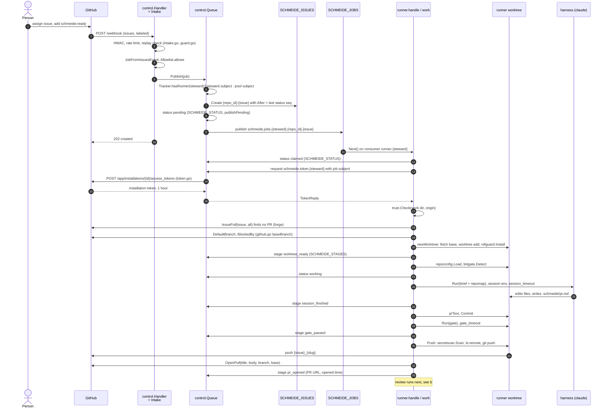
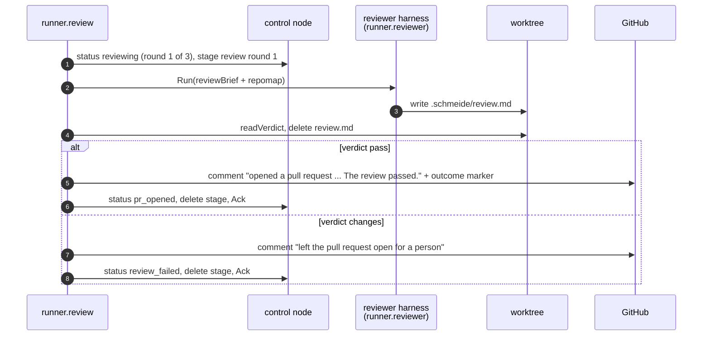
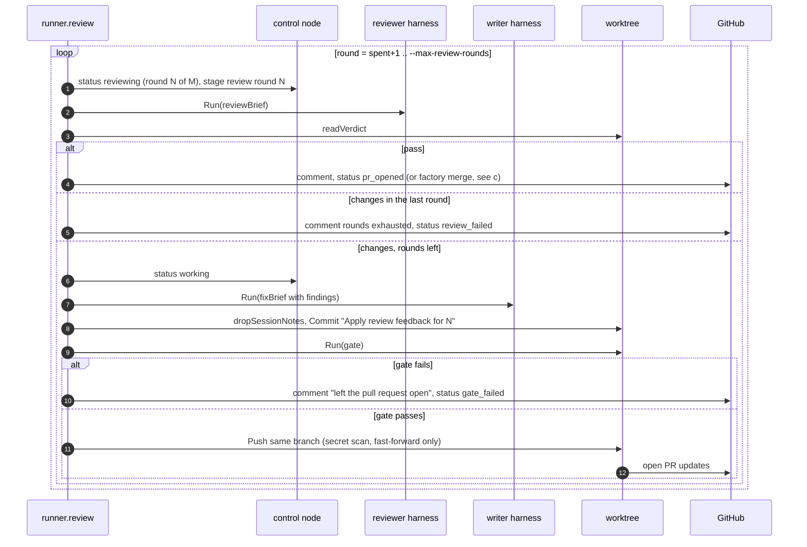
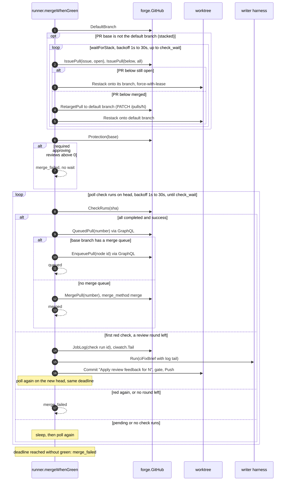
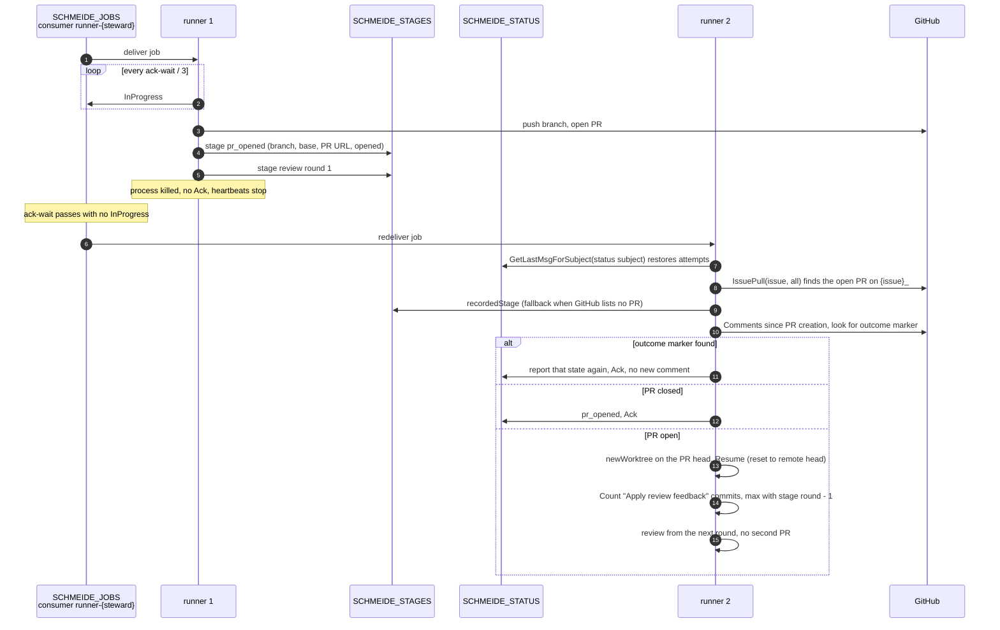
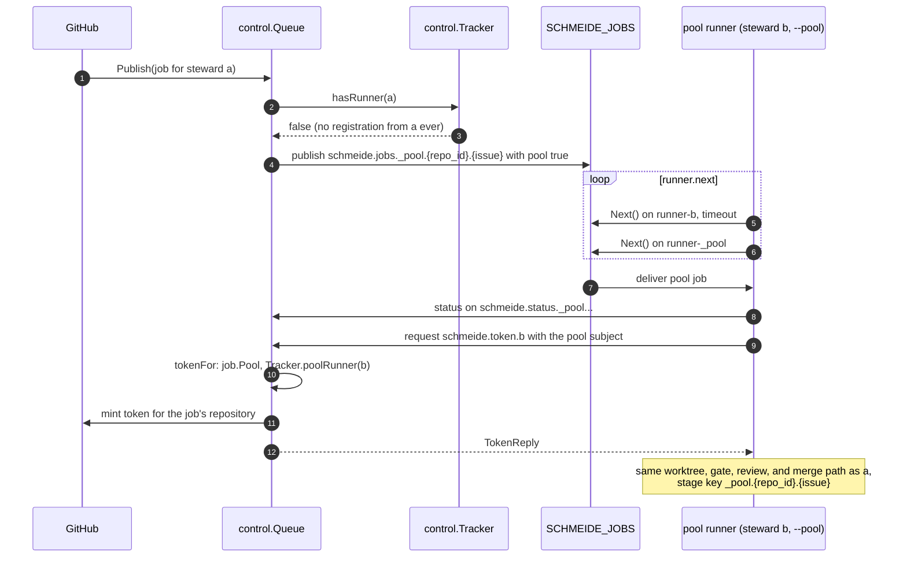
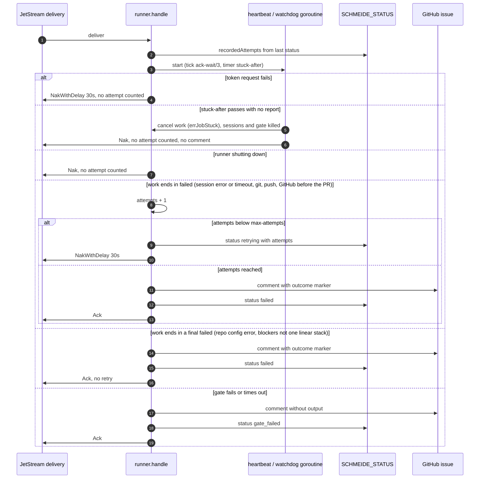

# Job flows

The paths below cover what the factory does at runtime. Each step names the package or file that owns it, so a
diagram doubles as a map for where to start reading. Policy (what is retried, what is final, and why) is in
[FAILURE-MODES.md](../FAILURE-MODES.md). This page shows the mechanism.

## a. Labeled issue to opened pull request

## b. Review rounds

### With `automate.review_fix` off

### With `automate.review_fix = "on"`

A reviewer file that is missing, has extra text after `pass`, or has `changes` with no findings ends the job as
`review_failed` (`readVerdict` in `internal/runner/review.go`).

## c. Factory merge

## d. A runner killed mid-job

The e2e journey `TestJourneyKilledRunnerJobIsRedeliveredWithoutASecondPullRequest` in `internal/e2e` drives this
path with a real binary.

The same path covers a control node restart while a runner holds a job: the runner keeps reconnecting
(`nats.MaxReconnects(-1)`), and if the lease lapses the job is redelivered and resumes the same way.

## e. Pool fallback

A pool job matches no steward's filter, because `_pool` is refused as a steward name at intake and in
`--runner-tokens`. A runner without `--pool` never creates the pool consumer. Once a steward has registered a
runner, that steward's later jobs go to the steward subject even when every one of its runners has stopped.

## f. Retries, timeouts, and the stuck-job drop

Deadlines are child contexts: `runSession` wraps each harness run in `session_timeout` (or `--session-timeout`),
and `runGate` wraps the gate in `gate_timeout` (or `--gate-timeout`). Both kill their process group on expiry,
and the resulting error is a `timeoutError` whose text carries no command output.
