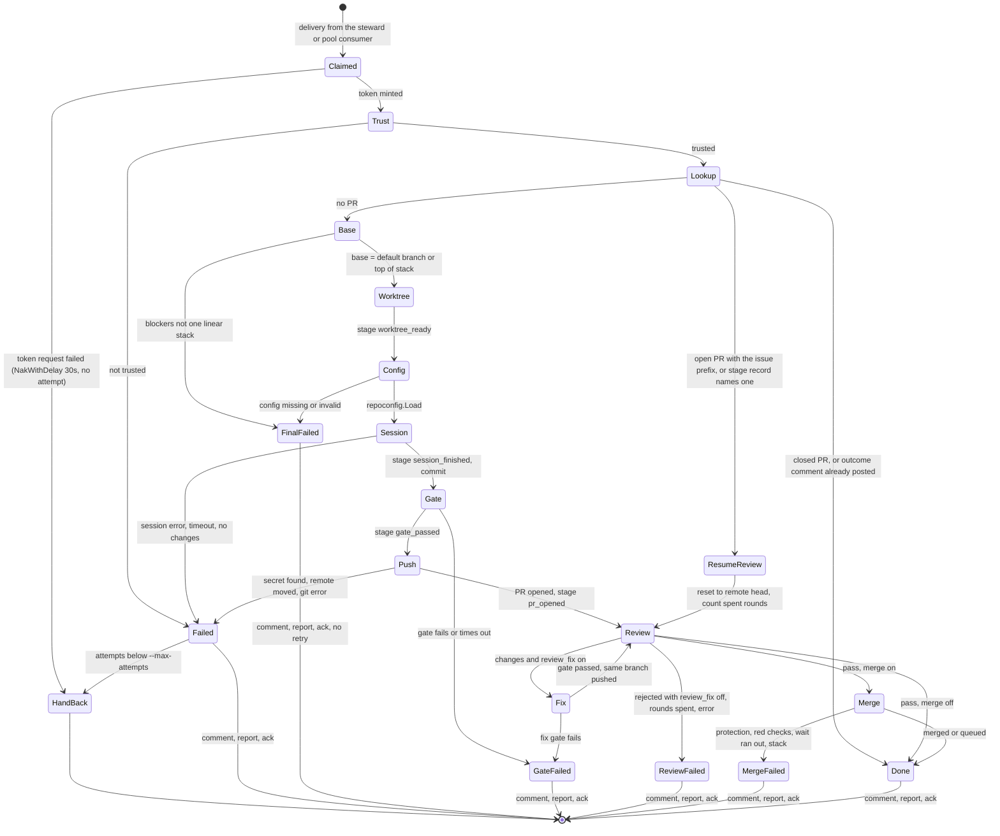

# Runner

`schmeide runner --steward <login>` pulls one steward's jobs from the control node and takes each to a pull
request, then reviews it and, when the repo asks, merges it. It works one job at a time. The job flow is in
`internal/runner`. The pieces it calls each live in their own package.

| Package or file | Owns |
| --- | --- |
| `internal/runner/cli.go` | `Main`, `runnerFlags`, `ParseFlags` (flag, then `SCHMEIDE_<NAME>`; a variable that does not parse for its flag is a usage error), `harnessFlags.check` (permission floor), `harnesses` (applies `--claude-args` and `--grok-args`), the terminal `confirm` prompt |
| `internal/runner/runner.go` | `Options`, `Connect`, `New`, `register`, `Run`, `next`, `handle` (delivery, heartbeat, retries, ack), `work`, `execute`, `open`, `brief`, `prText`, `BranchName`, `gateOutcome`, the stage record (`mark`, `recordedStage`) |
| `internal/runner/workspace.go` | `Workspace` interface and the git `worktree` implementation: `newWorktree`, `Commit`, `Run` (the gate), `Push`, `Resume`, `Count`, `Restack`, `BaseMerged`, `Close` |
| `internal/runner/review.go` | `review`, `reviewOnce`, `reviewer` (harness choice for review), `applyFindings`, `readVerdict`, `session` (every harness `Request`), `promptWithMap` |
| `internal/runner/merge.go` | `mergeWhenGreen`, `judgeChecks`, `fixCheck`, `waitForStack`, `restack`, `retarget`, `stackedOn` |
| `internal/runner/github.go` | `baseBranch` and `stackBelow` (stacked PR base), the `github` wrapper with `RetargetPull`, the outcome marker (`markOutcome`, `postedOutcome`), `pullNumber` |
| `internal/runner/env.go` | `baseEnv`, `harnessPrefixes`, `harnessEnv`: the session environment allow-list |
| `internal/runner/cache.go` | `goCacheEnv`: shared `GOCACHE`, `GOMODCACHE`, `GOFLAGS=-modcacherw` |
| `internal/harness` | `Harness` interface (`Name`, `Check`, `Run`), `All()` (Claude Code first, then Grok), `ClaudeCode`, `Grok`, `WideningArg`, `Fake` for tests |
| `internal/forge` | `Forge` interface, `GitHub` (REST plus GraphQL for the merge queue), `Fake` |
| `internal/repoconfig` | `Load` and `Parse` of `.schmeide/config.toml`: gate, `check_wait`, `gate_timeout`, `session_timeout`, `[automate]` |
| `internal/trust` | `Check`: the per (work directory, origin) trust prompt and its record |
| `internal/refguard` | `Install`: a `reference-transaction` hook so a worktree can move only its own branch |
| `internal/secretscan` | `ScanDiff`: credential-shaped literals and the job's own tokens on the lines a branch adds, run before every push; `Scan` reads every tracked file |
| `internal/lintgate` | `Detect` and `Warning`: a warning comment when the gate skips a `make check` target or pre-commit config |
| `internal/ciwatch` | `Run` (a check run), `NeedsTail`, `Tail` (last 4000 bytes of a check log) |
| `internal/repomap` | `Map`: up to 8 KiB listing tracked files and Go top-level names, appended to every prompt |

## Startup and connection

`Main` parses flags, refuses `--claude-args` or `--grok-args` that widen the permission floor unless
`--allow-dangerous-harness-args` is set (`harness.WideningArg`), and sets `Options.Confirm` only when stdin is a
terminal. `New` then:

1. Validates the steward (not empty, not `_pool`, no subject syntax) and fills defaults: `--ack-wait` 5m,
   `--stuck-after` 3h, `--max-attempts` 3, `--max-review-rounds` 3, retry delay 30s (no flag),
   `--session-timeout` 2h, `--gate-timeout` 30m. `--work-dir` is made absolute.
2. `Connect`: dials `--nats-url` as user `<steward>` with `--nats-token`, inbox prefix `_INBOX_<steward>`,
   unlimited reconnects, then sends an empty request on `schmeide.token.<steward>`. Only a control node answers
   it, so a wrong URL fails here with a message saying what to check.
3. `register`: requires `git` on `PATH`, runs `Check` on every harness and picks the first that passes as the
   writer, opens the steward consumer and, with `--pool`, the pool consumer (`sharedConsumer`: created with
   this runner's `--ack-wait` when missing, used unchanged when another runner created it), opens the
   `SCHMEIDE_STATUS` stream and `SCHMEIDE_STAGES` bucket (each optional, for older control nodes), and publishes
   the `Registration` with the names of every harness that passed.

`Run` loops on `next`, which fetches from the steward consumer with a one-second wait and, only when that times
out and `--pool` is set, from the pool consumer. So a runner always takes its own steward's job first. It returns
an error when the NATS connection is closed.

While `Run` runs, `keepRegistered` publishes the same `Registration` again on `schmeide.runners.<steward>.<host>` (`control.RegisterSubject`) every
`control.RegistrationInterval` (1 minute), including while a job is being worked. The control node counts a
registration for `control.RegistrationTTL` (3 minutes), so this refresh is what keeps a long-running runner in pool
routing and in `schmeide status`. A publish that fails is logged as `could not report to the control node` with
the subject, and the next tick tries again; it does not stop the runner. When `ctx` is canceled or `Run` returns,
the refresh stops before `Run` returns, so a stopped runner's registration expires three minutes after its last
refresh.

## A job inside the runner



`handle` in `runner.go` owns the delivery and `work` and `execute` own the job:

1. **Claim.** Decode the job, and `Term` it when it does not decode or its subject does not match. Restore the
   attempt count from the last status on the job's status subject (`recordedAttempts`). Start the heartbeat
   goroutine. Report `claimed`.
2. **Token.** Request the job's token on `schmeide.token.<steward>` with the job subject as the body. On failure,
   `NakWithDelay(30s)` without counting an attempt, since without a token nothing can be posted on the issue. The
   token is held in a `jobToken` (`internal/runner/token.go`) that every later GitHub call and git command asks,
   and that requests a new one when the held one is within five minutes of expiry. See
   [Credentials](credentials.md#refreshing-a-jobs-token).
3. **Issue text.** A job with an empty title predates jobs carrying the issue text and fails with a message to
   relabel the issue.
4. **Trust.** `trust.Check(workDir, origin, confirm)`. See [Trust prompt](#trust-prompt).
5. **Existing pull request.** `IssuePull(issue, "all")` finds the first pull request whose head starts with
   `<issue>_`. When GitHub returns none but the stage record names a PR, the record is used, because GitHub can
   leave a just-opened PR out of its list. When a PR exists:
   - `postedOutcome` looks for a bot comment since the PR's creation that carries the
     `<!-- schmeide:outcome <state> -->` marker. If one exists, only the ack was lost: that state is reported
     again and nothing is posted.
   - A closed PR ends the job as `pr_opened` with no comment.
   - An open PR resumes at review on its head and base.
6. **Base.** With no PR, `baseBranch` picks the base (see [Stacked pull requests](#stacked-pull-requests)).
   Blockers that are not one linear stack (`errNotOneStack`) fail the job finally.
7. **Worktree.** `newWorktree`, then mark stage `worktree_ready`.
8. **Repo config.** `repoconfig.Load` from the worktree, which is still the base branch. The gate, timeouts,
   `check_wait`, and `[automate]` come from here, before any session runs. A load error (missing file or
   invalid content) fails the job finally (`finalFailed`). `warnLintGate` comments a warning
   when the gate does not mention a detected `make check` target or pre-commit config.
9. **Writer session** (`open`): report `working`, run the harness with `brief(job, gate)`, mark
   `session_finished`. Read `.schmeide/pr.md` for the PR title and body and delete it (`prText`). The issue title
   is the fallback, and `Closes #N` is appended when missing. Commit with that title. No change fails the job.
10. **Gate.** `Workspace.Run` with the gate timeout. Failure or timeout is `gate_failed`. Mark `gate_passed`.
11. **Push and open.** `Workspace.Push`, then `OpenPull(title, body, branch, base)`. Mark `pr_opened` with the URL
    and the open time.
12. **Review**, then **merge** when `automate.merge = "on"`. See below.
13. **Finish.** Comment the outcome on the issue with the marker appended, report the final state, delete the
    stage record, and `Ack`.
14. **Revoke.** `Runner.revoke` calls `github.RevokeToken` (`github.go`), which sends
    `DELETE /installation/token` with the token the delivery holds at that point (`jobToken.current`, which does
    not refresh; a token a refresh replaced is left to expire). It is deferred right after the token arrives, so it
    runs however the delivery ends: a final state, a `retrying` hand-back, a stuck-job drop, or a shutdown. It
    runs on a context a shutdown does not cancel, with a 30 second deadline. A failure logs "could not revoke the
    job's token; it expires within the hour" and changes nothing else. A delivery whose token request failed has
    nothing to revoke.

### Retries and acknowledgment

The job is acknowledged only after a final outcome. Only outcomes in state `failed` are retried, and not those
marked `final` by `finalFailed`: a repo config load error and blockers that are not one linear stack. A retry
cannot change either, so they comment and ack on the first attempt. When the
attempt count after this failure is below `--max-attempts`, the runner reports `retrying`, flushes so the count
is stored on `SCHMEIDE_STATUS`, and `NakWithDelay(30s)`. Otherwise it comments and acks. The count lives in each
status's `attempts` field, so a restarted runner, or a different runner of the same steward, continues it. A new
job for an issue whose last job ended `failed` starts at zero: the control node's `pending` status for the new job
is the latest on the subject and carries no `attempts`. A
`map[string]int` in the process is the fallback when the status stream cannot be read.

Hand-backs that do not count: a failed token request, a shutdown (the parent context is canceled, so the job is
`Nak`ed at once), and the stuck watchdog. `gate_failed`, `review_failed`, `merge_failed`, `pr_opened`, `merged`,
and `queued` are never retried.

### Heartbeat and the stuck watchdog

The goroutine in `handle` sends `msg.InProgress()` every third of the consumers' `AckWait` (`Runner.ackWait`,
the shorter of the two for a `--pool` runner), which differs from `--ack-wait` when another runner created the
consumer. Every `report` call signals a `progress`
channel that resets a `--stuck-after` timer. When the timer fires, the goroutine cancels the work context with
`errJobStuck` and `Nak`s the delivery. The job's processes are killed through their process groups, and
`handle` returns without commenting or acking.

## Trust prompt

`internal/trust` keeps the runner from running agent sessions and gate commands for an origin the operator has
not agreed to, in a directory the operator has not agreed to. `Check` is called at the start of every job:

- `SCHMEIDE_TRUST=1` trusts every pair for the process and records nothing.
- A recorded yes is a file at `os.UserConfigDir()/schmeide/trust/<sha256(canonical dir + NUL + origin)>`, mode
  0600, in a 0700 directory. The canonical dir is absolute with symlinks resolved.
- Otherwise, with a terminal, the runner asks `[y/N]` on stderr and records a yes. Without a terminal it fails
  the job with a message naming both fixes. That failure counts as an attempt.

A different origin asks again, even for the same work directory.

## Work directory layout

```
<work-dir>/                         --work-dir, default ./schmeide-work, made absolute
  repos/<repo_id>.git/              bare clone, created once per repository, reused by every job
  worktrees/<repo_id>-<issue>/      one job's worktree, on branch <issue>_<slug>
    .schmeide-refguard/             hooks dir (core.hooksPath for this worktree), ignores itself
      reference-transaction
  cache/<repo_id>/
    go-build/                       GOCACHE shared by the gate and every session for this repository
    pkg/mod/                        GOMODCACHE, written with -modcacherw
  scratch/<repo_id>-<issue>/        the gate's HOME and TMPDIR, mode 0700, removed by Close
```

`newWorktree` (`workspace.go`):

1. Creates `repos/<repo_id>.git` with `git init --bare` the first time.
2. Turns on `extensions.worktreeConfig`, keeps `core.bare=true` in the clone's worktree config and sets the shared
   `core.bare=false`, so linked worktrees work and per-worktree hooks are possible.
3. `git worktree prune`, then fetches only the base branch into `refs/remotes/origin/<base>` and runs
   `git worktree add -B <branch> worktrees/<repo_id>-<issue> refs/remotes/origin/<base>`. A leftover worktree
   directory from an interrupted attempt is removed first.
4. Installs the ref guard and sets `core.hooksPath` in the worktree's own config.

Before step 1 it removes any leftover `scratch/<repo_id>-<issue>` and creates it again with mode `0700`. A
failure there fails the job with `create the gate scratch directory: <err>; check that --work-dir is writable`.

`Close` runs `git worktree remove --force`, deletes the local branch, and removes the scratch directory. The clone
and the caches stay.

Commits are made with `-c commit.gpgsign=false` as `--git-name` / `--git-email` (default `schmeide[bot]`), passed
through `GIT_AUTHOR_*` and `GIT_COMMITTER_*`.

### Ref guard

`refguard.Install` writes a `reference-transaction` hook. In the `prepared` phase it refuses any change to a
`refs/heads/<digits>_*` ref other than the job's own branch. A session therefore cannot create, move, or delete
another job's branch through git in that worktree. Branches with other names are not covered.

## Branch naming

`BranchName(issue, title)` is `<issue>_<slug>`: the title lowercased, runs of anything outside `[a-z0-9]` turned
into `-`, trimmed, cut to 40 characters, and `issue` when empty. Everything that finds a job's pull request
matches only the `<issue>_` prefix (`forge.GitHub.IssuePull`), so a retitled issue still finds its branch, and
the ref guard and `stackedOn` read the issue number back from the same prefix.

## The brief and the session environment

`brief(job, gate)` names the issue, repository, title, and body from the job, tells the session to follow the
repository's conventions, stay in the directory, not push or open a PR, names the gate, and asks for the PR text
in `.schmeide/pr.md` with a `Closes #N` line. The review and fix briefs (`reviewBrief`, `fixBrief`,
`ciFixBrief`) follow the same shape. `promptWithMap` appends `repomap.Map(dir)` to every prompt.

`Runner.session` builds every `harness.Request`:

- `Dir` is the worktree.
- `Env` is `harnessEnv(os.Environ(), --pass-env)` plus the Go cache variables. See
  [Credentials](credentials.md#harness-session-environment) for the list.
- `Output` is the runner's stderr.

The prompt goes in on stdin: `claude --print --output-format stream-json --verbose <args>` and `grok -p -
<args>`, where `<args>` defaults to `--permission-mode acceptEdits`. With `stream-json`, Claude Code writes each
event (system init, assistant message, tool use, tool result, final result) to `Output` as one JSON line as it
happens, so the runner's stderr shows where a session stopped. Nothing in the runner parses this output: the
writer's results are the worktree and `.schmeide/pr.md`, and the reviewer's verdict is `.schmeide/review.md`. Each session starts in its own process session (`syscall.SysProcAttr{Setsid:
true}` in `internal/harness/claude.go` and `internal/harness/grok.go`), so it has no controlling terminal. A runner
started in an interactive terminal passes that terminal to the session as `Output`; were the session only a
background process group on it, the CLI's first terminal ioctl would get `SIGTTOU` and stop the session until
the session deadline killed it. The session leader also leads its own process group, which is killed with
`SIGKILL` (`syscall.Kill(-pid, SIGKILL)`) when the session ends for any reason or its context is canceled.

### Harness selection

- **Writer.** The first harness in `harness.All()` (Claude Code, then Grok) whose `Check` passed at startup.
  `ClaudeCode.Check` reads `claude auth status --json`. `Grok.Check` reads the first line of `grok models`.
- **Reviewer.** `Runner.reviewer` picks, at each round, the first harness other than the writer whose `Check`
  passes now, and falls back to the writer. On a machine with both CLIs logged in, Grok reviews Claude Code's
  change.

## The gate

`Workspace.Run` (`internal/runner/workspace.go`) runs `sh -c <gate>` in the worktree, in its own process session
(`Setsid`), detached from the runner's terminal so `SIGTTOU` and `SIGTTIN` cannot stop it, with `cmd.Cancel`
killing the session leader's process group.
The environment is `gateEnv(os.Environ(), --gate-pass-env)`: the base list, `LC_*` and `XDG_*`, and the
`--gate-pass-env` names, never a `SCHMEIDE_*` name and never the harness prefixes. `scratchHome` then points `HOME`
and `TMPDIR` at the job's scratch directory, and the Go cache variables are added. See
[credentials.md](credentials.md#gate-environment). The deadline is `gate_timeout` from the repo config,
or `--gate-timeout`. A failure posts the command and error on the issue but never the output; the last 4000
bytes of output go to the runner log only (`gateOutcome`). A gate failure is final.

## Secret scan before push

`Workspace.Push` and `Workspace.Restack` call `worktree.scanSecrets` (`workspace.go`) before any `git push`. It
runs `secretscan.ScanDiff(worktree, baseRef, credentials)`, which reads `git diff -U0 -M <baseRef>...HEAD` (real git
binary, minimal environment) and checks only the added lines. `baseRef` is `refs/remotes/origin/<base>`; after a
restack it is the new base. It matches PEM private keys, `ghp_`, `gho_`, `ghu_`, `ghs_`, `ghr_`, and
`github_pat_` tokens, `glpat-` tokens, `AKIA` keys, JWTs, `sk-ant-` Anthropic keys, and `xai-` xAI keys, skipping
a line with `schmeide:allow-secret`. It also refuses an exact match of the job's installation token
(`worktreeSpec.token`) and of the runner's NATS token (`worktreeSpec.secrets`, from `--nats-token`), whatever the
line says. A hit refuses the push and names file, line, and kind, never the text. A literal that is already on
the base, or that a rename carries over unchanged, is not read, so it does not block the job.

`Push` then refuses to overwrite a remote branch whose head is not an ancestor of the local `HEAD`, and pushes
without force. `Restack` force-pushes with `--force-with-lease` pinned to the head it started from.

## Stacked pull requests

`baseBranch` (`github.go`) reads the repository default branch and the issue's blocked-by list
(`/issues/<n>/dependencies/blocked_by`). For each open blocker it looks for an open PR on `<blocker>_`. No such
PR means the default branch. Otherwise the base is the head of the one PR whose chain of bases (`stackBelow`)
contains every other blocker's head. Blockers that are not one chain return `errNotOneStack`, and the job fails
finally with one comment and no retry. The worktree
is created from that base and the PR opens against it.

## Review loop

`review` (`review.go`) runs rounds `spent+1` through `--max-review-rounds`:

1. Report `reviewing` (`round N of M`) and record stage `review` with the round number.
2. `reviewOnce`: a fresh reviewer session with `reviewBrief`. The reviewer must write `.schmeide/review.md`: the
   single line `pass`, or `changes` followed by findings. `readVerdict` reads and deletes it. Anything else is an
   error and ends the job as `review_failed`.
3. `pass` returns `pr_opened` with the comment "The review passed."
4. `changes` with `automate.review_fix` off returns `review_failed` and leaves the PR for a person.
5. `changes` in the last round returns `review_failed` (rounds exhausted).
6. Otherwise `applyFindings`: report `working`, run a writer session with `fixBrief`, delete the session note
   files, commit as `Apply review feedback for #N` (`fixMessage`), run the gate, push the same branch.

On a resumed job, `spent` is the number of `Apply review feedback for #N` commits on the branch (`Workspace.Count`),
or the recorded round minus one when larger, so a redelivery does not repeat spent rounds.

## Factory merge

Only when `automate.merge = "on"` and review passed. `mergeWhenGreen` (`merge.go`):

1. Reads the default branch. When the PR's base is not the default branch, `waitForStack` waits up to
   `check_wait` for the PR below to merge: while it is open each poll restacks onto it. A closed PR below with no
   `merged_at` still counts as merged when `Workspace.BaseMerged` finds the base this branch last built on, or the
   PR below's latest head (`refs/pull/<n>/head`, else the base branch), in the default branch; a head that cannot
   be fetched does not count. Once it merged the PR is
   retargeted with `RetargetPull` (REST `PATCH /pulls/<n>`) when GitHub has not already done so, and rebased onto
   the default branch.
2. Reads branch protection on the base (`Forge.Protection`). Required approving reviews fail the job before the
   wait. A 404 or 403 reads as no protection.
3. Polls check runs on the head with backoff from 1s doubling to 30s, the last poll landing on the end of
   `check_wait` (default 2m). No check runs is pending, not green.
4. The first red check, when a review round remains, runs `fixCheck`: one writer session with `ciFixBrief` and
   the last 4000 bytes of that check's Actions job log, the gate, and a push. The commit uses the review fix
   subject, so it counts as a round. Polling continues on the new head inside the same wait. A second red check
   fails the job.
5. Green: `QueuedPull` asks GraphQL whether the base branch has a merge queue. If so `EnqueuePull` and the job
   ends `queued`. Otherwise `MergePull` with `merge_method: merge` and the job ends `merged`.

Every failure is `merge_failed`, final, and leaves the PR open. Failures after green checks start with "CI is
green, but".

## What gets commented on the issue

| When | Comment | State |
| --- | --- | --- |
| Gate does not mention a detected lint target | the `lintgate.Warning` text, job continues | none |
| Work failed after `--max-attempts` | "schmeide could not finish this job and did not open a pull request:" plus the error | `failed` |
| Repo config missing or invalid, or blockers not one linear stack (first attempt, no retry) | "schmeide could not finish this job and did not open a pull request:" plus the error | `failed` |
| Gate failed or timed out, no PR | "schmeide did not open a pull request:" plus command and error, no output | `gate_failed` |
| Gate failed on a fix round | "schmeide left the pull request open:" plus command, error, PR URL | `gate_failed` |
| Review passed | "schmeide opened a pull request for this issue:" plus the URL and "The review passed." | `pr_opened` |
| Review requested changes, `review_fix` off | "left the pull request open for a person because ..." | `review_failed` |
| Rounds exhausted, or a post-PR error | "schmeide failed this job ... and left the pull request open" | `review_failed` |
| Merged | "schmeide merged the pull request after the review passed and CI succeeded" | `merged` |
| Enqueued | "schmeide added the pull request to the merge queue ..." | `queued` |
| Merge did not land | "schmeide failed this job and left the pull request open:" plus the reason | `merge_failed` |

Every outcome comment ends with `<!-- schmeide:outcome <state> -->`. No comment is posted for a hand-back, a
`retrying` attempt, a stuck hand-back, an already-posted outcome, or a PR found closed.
