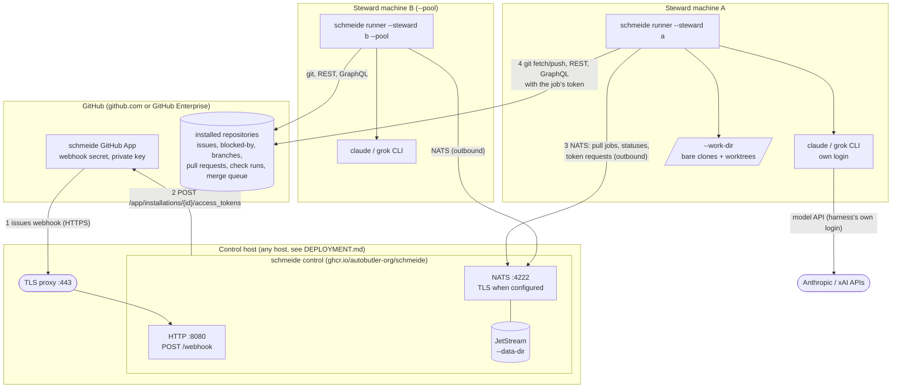

# System context

schmeide has three kinds of participant: GitHub, one control node, and any number of runners. Each runner drives
an agent harness that is already installed and logged in on its machine. This page says where each one runs,
what connects to what, and in which direction.

## Participants

| Participant | What it is | Where it runs | Code |
| --- | --- | --- | --- |
| GitHub App | The schmeide App. Owns the webhook secret and the private key. Branches, pull requests, and comments are authored by it. | GitHub | configured by the operator ([QUICKSTART.md](../QUICKSTART.md)) |
| Control node | `schmeide control`: one process with the webhook listener and an embedded NATS server with JetStream. | Any host GitHub can reach. Published as a container image, `ghcr.io/autobutler-org/schmeide:<version>`, whose default command is `control`. | `internal/control` |
| Runner | `schmeide runner --steward <login>`: pulls one steward's jobs and takes each to a pull request. | The steward's own machine, as a binary from `make install` or `go install`. The image does not contain git or a harness, so it cannot run a runner. | `internal/runner` and collaborators |
| Harness | An agent CLI: Claude Code (`claude`) or the Grok CLI (`grok`). Uses the login already on the machine. | Child process of the runner, in the job's worktree. | `internal/harness` |
| `schmeide status` | Asks the control node for the steward's own live registrations and unfinished jobs (plus pool jobs for a pool steward). | Anywhere that can reach NATS with a steward token. | `internal/control/status.go` (`StatusMain`) |
| `schmeide doctor` | Checks a runner machine: git, gh, disk, lint gate detection, harnesses, permission floor, control node reachability. | The runner machine. | `internal/doctor` |

## Connections

Every connection below is opened by the left-hand side. Nothing connects in to a runner.

| From | To | Protocol | Carries | Auth |
| --- | --- | --- | --- | --- |
| GitHub | control node `POST /webhook` | HTTPS to a proxy, then plain HTTP on `--http-addr` (default `:8080`) | `issues` events | `X-Hub-Signature-256` HMAC with the webhook secret |
| Control node | GitHub REST `POST /app/installations/{id}/access_tokens` | HTTPS | token requests | RS256 App JWT signed with the App private key |
| Runner | control node NATS on `--nats-addr` (default `127.0.0.1:4222`) | NATS, TLS when `--nats-tls-cert-file` and `--nats-tls-key-file` are set (`tls://` URL on the runner) | job pulls, acks, heartbeats, registration, statuses, stage records, token requests | NATS user = steward login, password = that steward's token |
| Runner | GitHub git (`--github-url`, default `https://github.com`) | HTTPS git | fetch base, push job branch | installation token as an `http.extraHeader` |
| Runner | GitHub REST and GraphQL (`--github-api-url`) | HTTPS | pulls, comments, blocked-by, check runs, job logs, branch protection, merge, merge queue | installation token as `Bearer` |
| Harness | its model provider | HTTPS | the session | the harness's own login (`ANTHROPIC_*`, `CLAUDE_*`, `XAI_*`, or its config under `HOME`) |
| `schmeide status`, `schmeide doctor` | control node NATS | NATS | a status query on `schmeide.status-query.<steward>`, a token-subject ping | a steward's NATS token |

The webhook listener is plain HTTP and the startup log says it must sit behind a TLS-terminating proxy. NATS
serves TLS itself, because a NATS client starts in plain text and upgrades after the server greeting, so a TLS
proxy cannot sit in front of it. Without TLS, `control.Run` refuses to start when `--nats-addr` listens beyond
loopback (`checkNATSTransport` and `listensBeyondLoopback` in `internal/control/tls.go`), unless
`--allow-plaintext-nats true` is set, in which case it starts and logs a warning.

## What lives where

| Thing | Location | Notes |
| --- | --- | --- |
| Job queue, issue records, stage records, status history | control node `--data-dir` (image: `/data`) | See [Data](data.md). Must be persistent storage. |
| App private key | file named by `--github-app-private-key-file` on the control host | Refused unless mode excludes group and other read. |
| Webhook secret, runner tokens | flag, `SCHMEIDE_*` env, or `--config` file on the control host | See [Credentials](credentials.md). |
| Repository clones and job worktrees | runner `--work-dir` (default `schmeide-work`) | Bare clone per repository, one worktree per job, shared Go caches. |
| Trust decisions | `os.UserConfigDir()/schmeide/trust/` on the runner machine | One file per (work directory, origin) pair. |
| Harness logins | the harness's own config on the runner machine | schmeide never reads, mints, or stores them. |
| Repo config | `.schmeide/config.toml` in each target repository | Read from the base branch. See [config.md](../config.md). |

## Deployment

schmeide is deployment-agnostic: nothing in the code assumes a cloud or host. The two requirements are that
GitHub can reach `POST /webhook` and runners can reach the NATS address. Ports, persistent storage, the container
settings, TLS, shutdown, and a reference VM-plus-Caddy pattern are in [DEPLOYMENT.md](../DEPLOYMENT.md). A
single-machine trial is in [QUICKSTART.md](../QUICKSTART.md). How versions are stamped and how runner and control
node skew is reported is in [VERSIONING.md](../VERSIONING.md).
