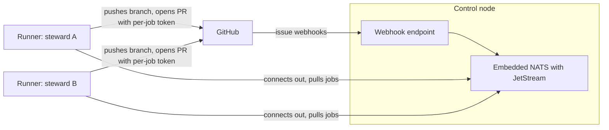

# schmeide design

This document records the design the team has agreed on so far. It is meant to
give a teammate enough context to pick up an issue. Anything not yet decided is
listed under [Open decisions](#open-decisions), not stated as fact.

## Purpose

schmeide is the software factory for autobutler-org: it takes a GitHub issue to
a reviewed pull request using AI agents, with people stepping in only where the
factory is stuck or a repo asks for a human merge.

It replaces [saddle](https://github.com/brandonapol/saddle), the tool currently
used to build quark. Saddle works for one operator on one laptop. These limits
are the reason for a new tool:

- **State is per laptop.** Tasks, claims, and the merge train live in a local
  SQLite file that is excluded from git, so nothing is shared between people.
- **Task IDs are per machine.** Two operators can produce the same ID, and
  branches with colliding IDs have already appeared on quark's remote.
- **There is no review stage.** CI and the merge queue are the only gate before
  a person presses merge.
- **Stacked PRs are fragile.** Much of saddle's open bug list is about
  restacking and how stacks interact with the merge queue.

## Scope

In scope:

- **Issue to PR.** Agents take an issue and produce a pull request.
- **Review and merge.** An AI review stage, and merging once the gates pass.

Out of scope for now: planning and intake (turning ideas into issues,
prioritizing, assigning) and keeping repo settings consistent across the org.

## Glossary

| Term | Meaning |
|---|---|
| Steward | The person who owns a job. For a job that comes from a GitHub issue, the steward is the issue assignee. |
| Control node | The single process that receives GitHub webhooks, holds the job queue, and hands out per-job GitHub tokens. |
| Runner | A process on a machine that has an agent harness installed and already logged in. It registers with the control node and pulls jobs. |
| Job | One unit of work: one GitHub issue to be taken to a pull request. |
| Harness | An agent CLI that a runner drives, such as Claude Code. |
| Gate | The command a repo requires to pass before a PR is opened, such as `make check test`. |

## Architecture

- **One control node binary.** `schmeide control` embeds a NATS server with
  JetStream for the queue and state. There is one process to host. It can be
  split into separate pieces later if it outgrows that.
- **Webhooks only.** The control node learns about issues from GitHub App
  webhooks. It does not poll GitHub.
- **Runners connect out.** A runner opens the connection to the control node,
  so a runner needs no inbound address.
- **Runners hold no GitHub credentials.** The control node mints a short-lived
  GitHub App installation token for each job and the runner uses that token to
  push and open the PR.
- **Runners bring their own agent login.** A runner uses the harness that is
  already installed and logged in on its machine. schmeide does not handle
  agent API keys.

## Job lifecycle

| Step | What happens | When |
|---|---|---|
| 1 | An issue is assigned and marked ready with a label. | First slice |
| 2 | GitHub delivers the webhook. The control node creates one job, with the assignee as steward. | First slice |
| 3 | A runner belonging to the steward pulls the job. | First slice |
| 4 | If the steward has no runner available, a pool runner takes the job. | Later |
| 5 | The runner creates a git worktree on a new branch and starts a fresh harness session with a brief built from the issue. | First slice |
| 6 | The runner runs the repo's gate command. A gate failure is reported on the issue and no PR is opened. | First slice |
| 7 | The runner pushes the branch and opens a PR as the schmeide GitHub App. | First slice |
| 8 | An AI reviewer checks the PR. The worker fixes what the reviewer finds until the review passes. | Later |
| 9 | With the review passed and CI green, the PR is merged by the factory or by a person, depending on the repo's config. | Later |

The details of steps 1 and 2 are in #3, and steps 3 and 5 to 7 are in #6.

## Decisions

### Intake

GitHub issues are the unit of work and the team-visible queue. An issue becomes
a job when it is assigned and carries the ready label.

### Routing

A job goes to its steward's own runners first. If none can take it, it falls
back to a pool of runners that have opted in to taking other people's work.

Pool runners spend their owner's agent subscription on someone else's job, so
the opt-in rules and limits need to be settled before the fallback is turned on.
See [Open decisions](#open-decisions).

### Identity

Branches and pull requests are authored by the schmeide GitHub App, not by a
person's account. This keeps people free to review and approve factory PRs, and
it means runners need no personal GitHub token.

### Review

A separate AI review stage gates every PR on top of CI. The reviewer runs as a
fresh harness session on the same runner, in the job's existing worktree, so
the checkout and toolchain are already in place.

### Merge

Each repo chooses in its tracked config whether the factory merges a PR that
has passed review and CI, or whether a person presses merge.

### PR shape

PRs are independent by default: one issue, one PR against the default branch.
PRs are stacked only when an issue declares a dependency on another issue.

### Harnesses

Harnesses are pluggable from the start. The runner drives a harness through an
adapter interface that states what every harness must support. Claude Code is
the first and, for now, only implementation. See #4.

### Isolation

Each job runs in its own git worktree on the runner's host, using the machine's
installed toolchains. Container isolation comes later, mainly for pooled work,
so the runner's job-execution interface should stay narrow enough to allow it.

### Repo config

Each repo the factory works on carries its own schmeide config, checked in and
reviewed like code. The first setting is the gate command. Other settings (merge
policy, reviewer prompts, declared dependencies) are added to the schema when
the feature that reads them is built. See #5.

### Deployment

schmeide is deployment-agnostic. The control node is a plain binary configured
by flags, environment variables, or a file, and nothing in the code, config
schema, or defaults may assume a particular host.

There are two requirements wherever it runs:

- GitHub must be able to reach the control node's webhook endpoint.
- Runners must be able to reach the control node.

For quark, the control node will be hosted through the `iac` repo. That is a
suggested deployment pattern and belongs in deployment docs, not in the design
of the tool. A control node without a public address needs a tunnel for
webhooks.

## First slice

Epic #7: one control node and one runner on the same machine take an assigned,
ready-labeled issue to an opened pull request, using Claude Code.

| Issue | Piece | Depends on |
|---|---|---|
| #3 | Control node with embedded NATS and webhook intake | |
| #4 | Harness adapter interface with the Claude Code implementation | |
| #5 | Tracked per-repo config with the gate command | |
| #6 | Runner that takes a job from issue to opened PR | #3, #4, #5 |

#3, #4, and #5 are independent of each other and can be built in parallel.

The schmeide GitHub App is a prerequisite for running the slice end to end.
Everything before that point can be tested with fake webhook payloads and a
fake harness.

Not in the first slice:

- Falling back to a pool of other people's runners
- The AI review stage and merging
- Stacked PRs for declared issue dependencies
- Container isolation for jobs
- Harnesses other than Claude Code
- Polling GitHub for issues

## Open decisions

None of these are settled. Where a value is given, it is a proposal.

| Decision | Proposal | Affects |
|---|---|---|
| Name of the ready label | `schmeide:ready` | #3 |
| Path and format of the per-repo config file | `.schmeide/config.toml` | #5 |
| Whether the control node restricts which orgs or App installations it accepts webhooks from | Take an allowlist and drop webhooks from anything else, so the control node does not depend on the App staying private | #3 |
| Shape of the job message that the control node publishes and the runner consumes | None yet. #3 is built first and will define it; #6 depends on it. | #3, #6 |
| How a runner opts in to pool work, and what limits apply | None yet. Needed before pool fallback is turned on. | Later |
| How #6 is verified end to end | Either against a test repo with the real App, or against a fake GitHub API with the real run as a manual check | #6 |

## Later

Roughly in the order they are expected to matter:

1. The AI review stage
2. Merging, with the per-repo choice between factory merge and human merge
3. Pool fallback, with opt-in and limits
4. Stacked PRs for issues that declare a dependency
5. Container isolation for jobs
6. A second harness
