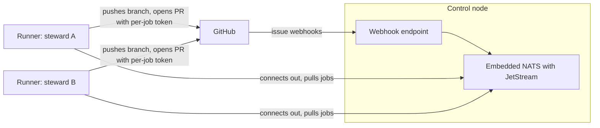

# schmeide design

This document records the design the team has agreed on so far. It is meant to
give a teammate enough context to pick up an issue. Accepted decisions are in
[Settled decisions](#settled-decisions). The Where column names the code that
implements a decision, or says the code is not updated in this change.
Anything not yet decided is listed under [Open decisions](#open-decisions),
not stated as fact.

## Purpose

schmeide is the software factory for autobutler-org: it takes a GitHub issue to
a reviewed pull request using AI agents, with people stepping in only where the
factory is stuck or a repo asks for a human merge.

It replaces [saddle](https://github.com/brandonapol/saddle), the tool currently
used to build quark. Saddle works for one operator on one laptop. These limits
are the reason for a new tool:

- **State is per laptop.** Tasks, claims, and the merge train live in a local
  SQLite file that is excluded from git, so nothing is shared between people.
- **Task IDs are per machine.** Two operators can produce the same ID, and
  branches with colliding IDs have already appeared on quark's remote.
- **There is no review stage.** CI and the merge queue are the only gate before
  a person presses merge.
- **Stacked PRs are fragile.** Much of saddle's open bug list is about
  restacking and how stacks interact with the merge queue.

## Scope

In scope:

- **Issue to PR.** Agents take an issue and produce a pull request. This is
  what the first slice does.
- **Review and merge.** An AI review stage, and merging once the gates pass.
  Both are built. Absent, empty, and `human` leave the pull request for a
  person. `factory` merges only when the repo config says so.

Out of scope for now: planning and intake (turning ideas into issues,
prioritizing, assigning) and keeping repo settings consistent across the org.

## Glossary

| Term | Meaning |
|---|---|
| Steward | The person who owns a job. For a job that comes from a GitHub issue, the steward is the issue assignee. |
| Control node | The single process that receives GitHub webhooks, holds the job queue, and hands out per-job GitHub tokens. |
| Runner | A process on a machine that has an agent harness installed and already logged in. It registers with the control node and pulls jobs. |
| Job | One unit of work: one GitHub issue to be taken to a pull request. |
| Harness | An agent CLI that a runner drives, such as Claude Code or the Grok CLI. |
| Gate | The command a repo requires to pass before a PR is opened, such as `make check test`. |

## Architecture

- **One control node binary.** `schmeide control` embeds a NATS server with
  JetStream. A KV bucket records each issue's latest job and whether it finished.
  Runner registration and the latest status of each job are stored on the
  SCHMEIDE_STATUS JetStream stream in the queue's data directory. A restarted
  control node loads them before it accepts new messages. There is one process
  to host. It can be split into separate pieces later if it outgrows that.
- **Webhooks only.** The control node learns about issues from GitHub App
  webhooks. The listener is HTTP and serves `POST /webhook`. It checks
  `X-Hub-Signature-256` against the App's webhook secret. It does not poll
  GitHub.
- **Runners connect out.** A runner opens the connection to the control node,
  so a runner needs no inbound address.
- **Per-job GitHub tokens, per-steward NATS tokens.** A runner has no
  long-lived GitHub credential and no personal GitHub token. See
  [Credentials and the job environment](#credentials-and-the-job-environment).
- **Runners bring their own agent login.** A runner uses the first harness
  whose `Check` passes on its machine. Claude Code and the Grok CLI are both
  built. See [Harnesses](#harnesses). schmeide does not mint or store agent
  keys. A harness session keeps `ANTHROPIC_*`, `CLAUDE_*`, and `XAI_*` from
  the runner's own environment so an existing login still works.

## Job lifecycle

| Step | What happens | When |
|---|---|---|
| 1 | An issue is assigned and marked ready with a label. | Done |
| 2 | GitHub delivers the webhook. The control node creates one job, with the assignee as steward, and stores the issue title and body from that delivery. | Done |
| 3 | A runner belonging to the steward pulls the job. | Done |
| 4 | When the assignee has a registered runner, the job stays on that steward's subject. When the assignee has no registered runner, the job is published on a pool subject. `--pool` defaults off. A runner that sets it registers as a pool runner. Pool runners share one consumer, work one job at a time, and take their own job first. The token, gate, review, and merge path are the same. | Done |
| 5 | The runner creates a git worktree on a new branch and starts a fresh harness session with a brief built from the title and body stored on the job. | Done |
| 6 | The runner runs the repo's gate command. A gate failure is commented on the issue, without the command output, and no PR is opened. | Done |
| 7 | The runner pushes the branch and opens a PR as the schmeide GitHub App. | Done |
| 8 | An AI reviewer checks the PR. The worker fixes what the reviewer finds until the review passes or the round limit is reached. | Done |
| 9 | After review passes, absent, empty, and `human` leave the pull request for a person. `factory` merges with a merge commit only when every check run on the head has succeeded within `check_wait` (default two minutes). When the base branch has a merge queue, green checks add the pull request to the queue instead, and the job is reported merged once it is queued. No check runs is not green. The first failed check in that wait runs one writer fix round, when a review round remains, and polling goes on at the new head inside the same wait. Still red, or a wait that ends without success, comments on the issue, leaves the pull request open, and is not retried. | Done |

Steps 1 to 3 and 5 to 7 shipped in the first slice (#3, #6, and the follow-ups
under [First slice](#first-slice)). Step 8, the AI review stage, has shipped.
Step 9, merging, has shipped. Step 4, pool fallback, has shipped. See
[Routing](#routing).

Before the first job in a new work directory and origin, the runner asks once
on its terminal. A yes is stored under the user config directory, in
`schmeide/trust`. `SCHMEIDE_TRUST=1` lets an unattended run proceed and records
nothing.

A second job for the same repository reuses the bare clone under the work
directory. The gate and the harness session share that repository's Go build
cache and module cache. Removing the work directory removes the cache.

For how a job fails and what is not retried, see
[FAILURE-MODES.md](FAILURE-MODES.md).

## Decisions

### Intake

GitHub issues are the unit of work and the team-visible queue. An issue becomes
a job when it is open, assigned, and carries the ready label, and the webhook
action is `labeled` or `assigned`. Edits and reopens do not create a job and do
not change one that already exists.

### Routing

When the assignee has a registered runner, the job stays on that steward's
subject. Several runners for one steward share one queue consumer, so each of
that steward's jobs goes to one of them.

When the assignee has no registered runner, the control node publishes the
job on a pool subject. `--pool` defaults off. A runner that sets it registers
as a pool runner. Pool runners share one consumer, work one job at a time,
and take their own job first. The token, gate, review, and merge path are the
same. A pool runner spends its owner's agent subscription on someone else's
job, so the flag defaults off.

A runner stays on one job. That is already how the code works, and the code
is not updated in this change.

### Identity

Branches and pull requests are authored by the schmeide GitHub App, not by a
person's account. This keeps people free to review and approve factory PRs, and
it means runners need no personal GitHub token. Commits default to
`schmeide[bot]` / `schmeide[bot]@users.noreply.github.com` (`--git-name` and
`--git-email`) and are made with commit signing turned off, so they are not
signed with the machine owner's key.

### Review

After the gate passes and the pull request is open, a fresh reviewer session
runs in the job's existing worktree, so the checkout and toolchain are already
in place. The reviewer writes its verdict to `.schmeide/review.md`. The runner
reads that file and removes it before any later commit. The runner allows up
to `--max-review-rounds` reviewer sessions (default 3). When the reviewer
requests changes and a round remains, a fresh worker session applies the
findings, the gate runs again, and the same branch is pushed. A pass finishes
the review. What happens next is under [Merge](#merge). Exhausting the rounds,
or a gate failure on a fix, comments on the issue and leaves the pull request
open.

### Merge

Each repo chooses in `.schmeide/config.toml` who merges a pull request after
review has passed. The `merge` key is optional. Absent, empty, and `human`
leave the pull request for a person. `factory` merges with a merge commit
after review only when every check run on the head has succeeded within
`check_wait`, an optional Go duration in the same config file (default two
minutes). No check runs is not green. When the base branch has a merge queue,
green checks add the pull request to the queue instead of merging it, and the
job is reported merged once it is queued.

The first failed check during the wait runs one writer fix round, when a
review round remains. The round counts against `--max-review-rounds`. The
runner gives the session the end of that check's log, runs the gate, pushes the
same branch, and keeps polling on the new head inside the same wait. There is
no second fix round. If the check is still red, or the wait ends without
success, the runner comments on the issue and leaves the pull request open.
That failure is final and is not retried. The runner reads `merge` with the gate, before the harness
session, so the session cannot turn factory merge on for itself
(`internal/repoconfig`, `internal/runner/merge.go`).

### PR shape

One issue is one pull request. The branch name is
`<issue number>_<short-description>`, taken from the issue title stored on
the job. A job whose repository already has a pull request, open or closed,
on a branch starting with `<issue number>_` is treated as already opened.
The check follows pages until that branch is found or a short page comes
back. The match is the `<issue number>_` prefix, including after a retitle,
and it counts open and closed pull requests.

Stacked pull requests have shipped (#58). The dependency is GitHub's
issue-dependencies blocked-by list, not a key in `.schmeide/config.toml`.
The worktree is created from the base branch, and the pull request opens
against that same branch. No open blocker with an open pull request whose
head branch starts with `<issue number>_` means the base is the repository
default branch. The prefix is that blocker's issue number. A blocker that
is not open, and an open blocker with no such pull request, do not count.
Exactly one such open blocker selects that pull request's head branch as
the base. Two or more such open blockers fail the job. The runner comments
on the issue that only one open dependency is supported and does not open a
pull request (`internal/runner/github.go`, `internal/runner/runner.go`).

### Harnesses

Harnesses are pluggable. The runner drives a harness through an adapter
interface that states what every harness must support. Claude Code and the
Grok CLI are both implementations (`internal/harness`). The Grok adapter
shells out to the Grok CLI, the same shape as the Claude Code adapter, with
no new module dependency.

`All()` offers Claude Code first and the Grok CLI second. The runner uses
the first harness whose `Check` passes, so a working Claude Code is still
selected. The runner offers that list, and `--claude-args` applies only to
Claude Code (`internal/runner/cli.go`, `internal/runner/runner.go`). A
missing or logged-out harness is skipped when another one is ready. Doctor
fails the harness check only when every harness fails (`internal/doctor`).

Every session starts from a permission floor. `--claude-args` and
`--grok-args` both default to `--permission-mode acceptEdits`. The runner
refuses to start when either contains `--dangerously-skip-permissions` or a
`--permission-mode` other than `acceptEdits`, unless
`--allow-dangerous-harness-args` is set. An OS sandbox is not part of this
floor. See [harness permissions](permissions.md).

### Isolation

Each job runs in its own git worktree on the runner's host, using the machine's
installed toolchains. The job flow is written against a `Workspace` interface
so a container backend can replace the worktree later. Container isolation is
not built. It is aimed at pooled work.

What a job's processes may see is under
[Credentials and the job environment](#credentials-and-the-job-environment).
The session and the gate run as the operating-system user that started the
runner.

### Repo config

Each repo the factory works on carries its own schmeide config, checked in and
reviewed like code. The file is `.schmeide/config.toml`. `gate` is required:
the command that must pass before a PR is opened. `merge` is optional. Absent,
empty, and `human` leave the pull request for a person. `factory` is the only
other legal value, and [Merge](#merge) is what it does. Unknown keys are an
error. `gate_timeout` and `session_timeout` are optional Go durations. Absent
or empty keeps the runner flag: `--gate-timeout` defaults to 30 minutes and
`--session-timeout` defaults to 2 hours. A positive value overrides that flag
for the repo. An unparseable or non-positive value is a config error that
names the key and gives `30m` as an example. When a deadline fires, the
runner cancels that process group, fails the job, and comments on the issue
that the session or the gate timed out. The comment does not include the
command's output. The runner reads the file before the harness session, so
the session cannot change the gate it is about to be held to, cannot turn
factory merge on for itself, and cannot lengthen its own deadline. Other
settings, such as reviewer prompts, are added to the schema when the feature
that reads them is built. A pull request
dependency is GitHub's issue-dependencies blocked-by list, not a key in
this file. See [PR shape](#pr-shape).

### Credentials and the job environment

A runner stores no long-lived GitHub credential. When it takes a job it asks
the control node on `schmeide.token.<steward>`, with the job's subject as the
request. The control node loads that job from the stream and mints a GitHub
App installation token limited to the job's repository and to `contents:
write`, `pull_requests: write`, `issues: write`, and `checks: read`
(`internal/control/token.go`). The request is refused when the subject is not
one of that steward's jobs. GitHub expires an installation token after one
hour. Git receives the token as an `http.extraHeader` in that git command's
environment, so the token is not written into git config.

NATS access is per steward. `--runner-tokens` is a comma-separated list of
`<login>:<token>` entries. A runner connects as its steward, with that token,
and can only create that steward's consumer, pull and acknowledge that
steward's jobs, publish that steward's registration and statuses, and request
tokens on that steward's token subject. Replies use an inbox prefix for that
steward, so one steward cannot read another's token replies. The control
node's own NATS connection uses a generated password
(`internal/control/queue.go`).

`internal/runner/env.go` names what a job may see. The base list is `PATH`,
`HOME`, `USER`, `LOGNAME`, `SHELL`, `TERM`, `LANG`, `TZ`, `TMPDIR`, the proxy
variables (`HTTP_PROXY`, `HTTPS_PROXY`, `NO_PROXY`, and the lowercase forms),
`SSL_CERT_FILE`, `SSL_CERT_DIR`, any name starting with `LC_` or `XDG_`, and
any name passed in `--pass-env`. A harness session also sees names starting
with `ANTHROPIC_`, `CLAUDE_`, or `XAI_`. The session keeps those prefixes
from the runner's own environment so an existing login still works.
schmeide does not mint or store agent keys. The runner starts the session
with that environment, so the session does not see the runner's `SCHMEIDE_*`
settings, including its NATS token.

The worktree runs git and the gate with whatever environment it was given, and
adds the installation token only to git's environment. The runner does not pass
the base list when it creates the worktree (`internal/runner/runner.go`). Git's
environment is then only the token variables, and the gate inherits the runner
process's environment. The gate's output is not posted to the issue. The
comment names the command and the failure, and the output tail stays in the
runner's log.

### Deployment

schmeide is deployment-agnostic. The control node is a plain binary configured
by flags, environment variables, or a file, and nothing in the code, config
schema, or defaults may assume a particular host.

There are two requirements wherever it runs:

- GitHub must be able to reach the control node's webhook endpoint, `POST
  /webhook` on `--http-addr`. The listener is HTTP.
- Runners must be able to reach the control node's NATS address.

For quark, the control node will be hosted through the `iac` repo. That is a
suggested deployment pattern and belongs in deployment docs, not in the design
of the tool. A control node without a public address needs a tunnel for
webhooks.

`schmeide version` prints the version the Makefile baked in; an unstamped build
prints `dev`. When a runner registers, the control node compares versions. If
both are valid semver and differ, it logs a warning and still accepts the
runner. See [VERSIONING.md](VERSIONING.md).

## First slice

Epic #7 is done. One control node and one runner take an assigned,
ready-labeled issue to an opened pull request, using Claude Code.

| Issue | Piece | Depends on |
|---|---|---|
| #3 | Control node with embedded NATS and webhook intake | |
| #4 | Harness adapter interface with the Claude Code implementation | |
| #5 | Tracked per-repo config with the gate command | |
| #6 | Runner that takes a job from issue to opened PR | #3, #4, #5 |

Follow-ups that landed with the slice:

- **#14.** The control node subscribes to runner registration and job status.
  Both are stored on the SCHMEIDE_STATUS JetStream stream in the queue's data
  directory. A restarted control node loads them before it accepts new
  messages.
- **#15.** A job that fails for a reason other than the gate is tried again, up
  to `--max-attempts` (default 3). The runner counts those work failures
  itself, and a token hand-back or a shutdown does not consume an attempt. The
  count is kept in memory, and a restarted runner starts the attempt count
  over. A job whose stage record names an open pull request resumes at review
  and does not open a second one. A job with no pull request starts over. The wait before the next try is 30 seconds and has no flag. A gate
  failure is final. A pull request on a branch named `<issue number>_*`
  suppresses a second PR.
- **#16.** Webhooks are limited to an allowlist of orgs or App installations.
- **Pull request #30.** Runner credentials are scoped per steward, the job
  carries the issue text from the event that created it, the harness session
  runs with the reduced environment above, and the allowlist is required. An
  empty allowlist allows no job. A job queued before that change has no issue
  text; the runner fails it and says to remove the ready label and add it
  again.

The schmeide GitHub App is a prerequisite for a live delivery. Tests use saved
webhook payloads, a fake GitHub API, and a fake harness.

The AI review stage shipped after this slice. See [Review](#review). Merging
shipped after this slice. See [Merge](#merge). The Grok CLI harness shipped
after this slice. See [Harnesses](#harnesses). Pool fallback shipped after
this slice. See [Routing](#routing). Stacked pull requests shipped after
this slice. See [PR shape](#pr-shape).

Not in the first slice, and not shipped:

- Container isolation for jobs
- Polling GitHub for issues
- More than one job at a time on a runner. Accepted as no change: a runner stays on one job, which is already how the code works.

## Settled decisions

| Decision | Outcome | Where |
|---|---|---|
| Name of the ready label | `schmeide:ready`. Override with `--ready-label`. | `internal/control/intake.go` (`DefaultReadyLabel`) |
| Path and format of the per-repo config file | `.schmeide/config.toml`. `gate` is required and must be a non-empty command. `merge` is optional: absent, empty, and `human` leave the pull request for a person, and `factory` is the only other legal value. `gate_timeout` and `session_timeout` are optional Go durations. Absent or empty means the runner flag, which defaults to 30 minutes for the gate and 2 hours for a session. A positive value overrides that flag. An unparseable or non-positive value is an error that names the key and gives `30m` as an example. Unknown keys are an error. | `internal/repoconfig`, `internal/runner` |
| Which orgs or App installations may create jobs | Required. `--allowed-orgs` (owner logins, compared case-insensitively) or `--allowed-installations` (numeric installation IDs), or both. A job is accepted when it matches either list. `schmeide control` refuses to start when both are empty, and an empty allowlist allows no job. A delivery that would create a job and matches neither list is rejected with 403. A delivery that does not describe a ready job is ignored, including one from outside the allowlist. A bad signature is rejected before that check. | `internal/control/intake.go`, `internal/control/cli.go` |
| Shape of the job message | JSON with `repo`, `repo_id`, `issue`, `steward`, `installation_id`, `title`, and `body`, on `schmeide.jobs.<steward>.<repo id>.<issue>` when the assignee has a registered runner, and on a pool subject when the assignee has none. Created only for an open issue that has an assignee and the ready label, and only from an `issues` action of `labeled` or `assigned`. The steward is `issue.assignee`, or the first of `issue.assignees` when that is empty. One job per repository id and issue number; a repeat delivery is a duplicate and does not replace the stored text. The runner does not fetch the issue. | `internal/control/intake.go`, `internal/control/queue.go` |
| How the runner is verified | Automated tests. The runner tests stand up the embedded queue, a fake GitHub REST API, and a fake harness. Intake tests use saved webhook payloads. | `internal/runner/runner_test.go`, `internal/harness/fake.go`, `internal/control/testdata` |
| What a runner may authenticate as | A per-steward NATS token from `--runner-tokens`. A per-job GitHub App installation token scoped to that repository and to contents, pull requests, and issues write, and checks read. No long-lived GitHub credential on the runner. | `internal/control/queue.go`, `internal/control/token.go` |
| What a harness session may see | The base list in `internal/runner/env.go`, plus `ANTHROPIC_*`, `CLAUDE_*`, and `XAI_*` kept from the runner's own environment so an existing login still works, plus `--pass-env`. schmeide does not mint or store agent keys. Not the runner's `SCHMEIDE_*` settings. | `internal/runner/env.go`, `internal/runner/runner.go` |
| Pool opt-in (#31) | `--pool` defaults off. A runner that sets it registers as a pool runner. When the assignee has a registered runner, the job stays on that steward's subject. When the assignee has no registered runner, the job is published on a pool subject. Pool runners share one consumer, work one job at a time, and take their own job first. The token, gate, review, and merge path are the same. | `internal/runner/cli.go`, `internal/control/queue.go`, `internal/runner/runner.go` |
| Merge default (#32) | Absent, empty, and `human` leave the pull request for a person. `factory` merges with a merge commit after review only when every check run on the head has succeeded within `check_wait` (default two minutes). When the base branch has a merge queue, green checks add the pull request to the queue instead, and the job is reported merged once it is queued. No check runs is not green. The first failed check in that wait runs one writer fix round, when a review round remains, and polling goes on at the new head inside the same wait. Still red, or a wait that ends without success, comments on the issue, leaves the pull request open, and is not retried. | `internal/repoconfig`, `internal/runner/merge.go` |
| Dependency declaration (#34) | Shipped (#58). The dependency is GitHub's issue-dependencies blocked-by list, not a key in `.schmeide/config.toml`. The worktree is created from the base branch, and the pull request opens against that same branch. No open blocker with an open pull request whose head branch starts with `<issue number>_` means the base is the repository default branch. The prefix is that blocker's issue number. A blocker that is not open, and an open blocker with no such pull request, do not count. Exactly one such open blocker selects that pull request's head branch as the base. Two or more such open blockers fail the job. The runner comments on the issue that only one open dependency is supported and does not open a pull request. | `internal/runner/github.go`, `internal/runner/runner.go` |
| Second harness (#33) | Shell out to the Grok CLI, the same shape as the Claude Code adapter, with no new module dependency. `All()` offers Claude Code first and the Grok CLI second. The runner uses the first harness whose `Check` passes, so a working Claude Code is still selected. A missing or logged-out harness is skipped when another one is ready. Doctor fails the harness check only when every harness fails. `--claude-args` applies only to Claude Code. | `internal/harness`, `internal/doctor`, `internal/runner/cli.go`, `internal/runner/runner.go` |
| Concurrent jobs (#44) | A runner stays on one job. Accepted as no change. Already how the code works. | The code is not updated in this change. Already how the runner works. |

## Open decisions

- Which runtime isolates a pool job, whether that isolation applies only to
  pool jobs, and what image the job runs in. Proposed in #59 and not accepted,
  so container isolation stays unbuilt.

## Later

Roughly in the order they are expected to matter. None of these have been built:

1. Container isolation for jobs
